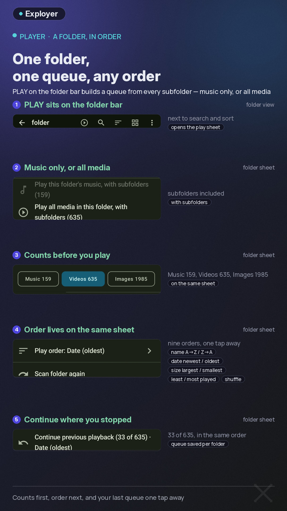

<div dir="rtl">

<p align="center">
  
</p>

<h1 align="center">Exployer — مدير ملفات ومُنزِّل فيديو ومتصفح ومحرِّر صور لأندرويد</h1>

<p align="center">
  <b>ملف APK واحد مجاني بدل خمس تطبيقات.</b><br>
  مدير ملفات بسلة مهملات ووسوم · مشغّل موسيقى وفيديو بتشغيل ذكي للمجلدات · متصفح بحاجب إعلانات ·
  مُنزِّل فيديو HLS/DASH · محرِّر صور وفيديو · قارئ ZIP · خزنة AES-256
</p>

<p align="center">
  <a href="https://github.com/balochscript/Exployer-App/releases/latest"></a>
  
  
  
</p>

<p align="center">
  <a href="https://github.com/balochscript/Exployer-App/releases/latest/download/exployer-0.9.103.apk"><b>⬇ نزِّل ملف APK (9.1 ميغابايت)</b></a>
  ·
  <a href="docs/FEATURES.md">كل الميزات</a>
  ·
  <a href="CHANGELOG.md">سجل التغييرات</a>
  ·
  <a href="FAQ.md">الأسئلة الشائعة</a>
  ·
  <a href="#التحقق">تحقَّق من البصمة</a>
</p>

<p align="center">
  <b>اقرأ بغير العربية:</b>
  <a href="README.md">English</a> ·
  <a href="README.fa.md">فارسی</a> ·
  <a href="README.es.md">Español</a> ·
  <a href="README.pt-BR.md">Português (BR)</a> ·
  <a href="README.id.md">Bahasa Indonesia</a> ·
  <a href="README.hi.md">हिन्दी</a> ·
  <a href="README.ar.md">العربية</a> ·
  <a href="README.ur.md">اردو</a>
</p>

---

## بنيتان، والميزات نفسها

| الملف | الحجم | متى تستخدمه |
|---|---|---|
| `exployer-0.9.103.apk` | **9.1 ميغابايت** | الخيار الاعتيادي. مصغَّر ومحسَّن بـ R8؛ الميزات والسلوك نفسها تمامًا. |
| `exployer-0.9.103-nor8.apk` | **18.0 ميغابايت** | للاحتياط فقط. الكود نفسه دون تصغير R8 — استخدمه إن أخفق البناء الصغير على جهاز غير مألوف. |

الملفان موقَّعان بالمفتاح نفسه ويمكن أن يحدِّث أحدهما الآخر. كلاهما versionCode **113**.

---

## لقطات الشاشة

| | | | |
|---|---|---|---|
|  |  |  |  |
| **مدير الملفات** | **شغِّل مجلدًا كاملًا** | **مشغل الفيديو** | **مشغل الموسيقى** |
|  |  |  | |
| **الوسوم** | **المتصفح** | **التنزيلات** | |

جميعها 1080 × 1920 وتوجد بالفارسية أيضًا — المجموعة الفارسية هي المعروضة في صفحة التطبيق على متجر Cafe
Bazaar. كيفية بناء المجموعتين وما تدّعيه التعليقات موضَّحة في [docs/screenshots/README.md](docs/screenshots/README.md).

---

## ما هو Exployer؟

Exployer تطبيق أندرويد واحد يغطي الأعمال اليومية التي يُثبِّت الناس لها خمس تطبيقات عادةً. بُني للهواتف بلا
حساب Google Play، وبلا روت، وبلا تسجيل: ثبِّت الـ APK، امنح إذن «الوصول لكل الملفات» مرة واحدة، وسيعمل
كل شيء على الجهاز.

لا سحابة، ولا رفع، ولا تتبع عن بُعد. الملفات وسجل التشغيل والوسوم والخزنة لا تترك الهاتف أبدًا.

## الميزات

الفهرس الكامل، مع تفاصيل كل بند، في [docs/FEATURES.md](docs/FEATURES.md).
وهذه هي القائمة الكاملة — الميزات الكبيرة والصغيرة.

### مدير الملفات
- التخزين الداخلي وبطاقة SD، عرض قائمة وشبكة، ومسار قابل للنقر للقفز إلى أي مجلد
- الترتيب بالاسم أو التاريخ أو الحجم أو النوع، في الاتجاهين؛ بحث شامل في كل التخزين
- تحديد مفرد ومتعدد وبمدى («من الأول إلى الأخير»)؛ نسخ، نقل، حذف، تسمية، مشاركة، خصائص
- ورقة نسخ/نقل بمسارها الخاص، مجلد جديد، ملفات مخفية
- ثماني فئات — صوت، فيديو، صور، مستندات، تنزيلات، APK، أرشيفات، جميع الملفات — مع بطاقة تخزين حيّة
  (مستخدم / حر / الكل) في الشاشة الرئيسية
- الملفات الأخيرة (آخر خمسة أيام) بفلتر نوعها، وفتح المجلد الحاوي، والخصائص؛ ويخبرك بصدق إذا كان
  التخزين أكبر من أن يُفحص كاملًا
- ضغط إلى ZIP، تشفير إلى `.enx`، فك التشفير، وتثبيت APK من القائمة نفسها
- عارض PDF ونصوص مدمج، فلا يحتاج المستند إلى مغادرة التطبيق
- سلة المهملات: الملفات المحذوفة تبقى قابلة للاستعادة حتى 30 يومًا، مع عدّاد تنازلي
- تحليل التخزين: أكبر المجلدات والملفات، مفصولة حسب النوع (يشمل ملفات التورنت)؛ كاشف الملفات المكررة
  ينقل النسخ الزائدة إلى سلة المهملات

### الوسوم
- وسِّم أي ملف لحظة رؤيته — من قائمة الملفات (ضغطة طويلة → تحديد → زر الوسم في شريط التحديد)، من شاشة
  Now Playing، أو من عارض الصور/الفيديو. لا سقف لعدد الوسوم على الملف الواحد
- الوسم الجماعي: حدِّد عدة ملفات وطبِّق وسمًا بعملية واحدة؛ يعرض المنتقي «3 من 5» إذا كان جزء من التحديد
  يحمل الوسم أصلًا، وتُظهر الشرائح الحالة: الكل / بعض / لا شيء
- عشرة ألوان تُسنَد تلقائيًا؛ إنشاء (حتى من داخل المنتقي)، تسمية، حذف — حذف وسم لا يحذف الملفات أبدًا،
  والحوار يقول ذلك
- يُرفض اسم الوسم المكرر (توحيد الحروف العربية/الفارسية المتشابهة أولًا)
- بحث داخل قائمة الوسوم؛ خمسة ترتيبات: الأكثر عناصر، الأقل عناصر، الأحدث، الأقدم، الموسومة مؤخرًا
- تشغيل وسم كامل: موسيقاه فقط أو كل وسائطه، بالترتيبات التسعة نفسها وبالاستئناف نفسه
- **MultiTagPlay**: اضغط طويلًا على عدة وسوم وشغِّل كل محتواها كقائمة واحدة؛ الملف المشترك بين وسمين
  مختارين يُشغَّل مرة واحدة لا مرتين؛ «متابعة التشغيل السابق» و«تحديد الكل» يحترمان البحث الحالي

### الموسيقى والفيديو
- مكتبة بتحديث صامت، قائمة انتظار، «أضف إلى القائمة»، سرعة التشغيل (0.25×–3.0×)، مؤقّت نوم بالوقت
  المتبقي، تكرار إيقاف / الكل / واحد، عشوائي
- موازن صوت بإعدادات جاهزة، وتعزيز باس، ومعزز فضائي (virtualizer)، مع زر إعادة ضبط؛ مشغّل مصغَّر دائم الظهور
- تشغيل في الخلفية مع أدوات تحكم في الإشعار؛ الإشعارات تتبع لغة التطبيق
- تشغيل مجلد كامل (بالمجلدات الفرعية، حتى 24 مستوى و20,000 ملف — ويقول ذلك إذا بلغ الحد فعلًا) بتسعة
  ترتيبات: الاسم A→Z، الاسم Z→A، الأحدث، الأقدم، الأكبر، الأصغر، الأقل تشغيلًا، الأكثر تشغيلًا، عشوائي كامل
- شرائح فلتر النوع (موسيقى / فيديو / صور) مع عدّادات، قابلة للتغيير قبل الضغط على تشغيل
- «متابعة التشغيل السابق»: القائمة والترتيب وفلتر النوع والعنصر الحالي محفوظة لكل مجلد وأرشيف ووسوم
  ومجموعة وسوم — والقائمة تعرض «متابعة من 7 من 42 · الأقل تشغيلًا»
- لا يُحتسب التشغيل إلا بعد 10 ثوانٍ أو 25 % تقدمًا، فمعنى «الأقل تشغيلًا» يكون حقيقيًا
- مشغل الفيديو: سحب أفقي للتنقل، عمودي للصوت والإضاءة، مدى تنقل بالسحب 0.5–20 %، ضغطة مزدوجة للإيقاف/
  التشغيل، الضغط المطوَّل للسرعة 2×، قفل اللمس، نسبة العرض (ملاءمة / قص / تمديد)، اختيار مسار صوت وترجمة،
  ملء الشاشة دون أشرطة النظام، تدوير يدوي، صورة داخل صورة، لقطة شاشة بلمسة واحدة، سلوك نهاية الفيديو
  (إعادة / إيقاف / التالي)، وسائط مرافقة، قصَّة وتقصير من داخل المشغل نفسه

### المتصفح (Baloch Core)
- العرض بمحرك Chromium النظامي؛ والتبويبات والحجب والخصوصية والإحصاءات كودٌ خاص بـ Exployer
- تبويبات ومعايناتها ومجموعاتها بثمانية ألوان — اسحب بطاقة تبويب إلى شريحة المجموعة، مع تراجع؛ إغلاق مجموعة
  يُبقي تبويباتها مفتوحة وقابلة للاستعادة 24 ساعة
- تبويبات تصفُّح خاص (لا يُحفظ شيء)، تبويبات مغلقة قابلة للاستعادة 24 ساعة، استعادة الجلسة بموضع التمرير
  الدقيق
- شريط التبويبات في خمسة مواضع (أعلى، أسفل، يسار، يمين، مخفي)؛ تبويبات بالأيقونة فقط؛ شريط سفلي اختياري
- حجب الإعلانات بقائمة دومينات منتقاة مع إخفاء مواضع الإعلانات؛ موفِّر البيانات يحجب الصور والفيديو الثقيل
  حتى تضغط «تحميل الكل» (معطَّل افتراضيًا)
- مفتاح اختياري Do Not Track / Sec-GPC (معطَّل افتراضيًا)؛ مسح السجل والمخزن المؤقت وملفات الارتباط عند الخروج
- صفحة رئيسية باختصارات قابلة للتعديل، قالب محرك بحث مخصص، بحث في الصفحة، تكبير لكل موقع يمكن تذكُّره،
  وضع سطح المكتب، حجم نص افتراضي، مؤشر HTTPS/HTTP
- علامات مرجعية، سجل، إحصاءات المتصفح (زيارات وتنزيلات إجمالية وأسبوعية، أكثر المواقع زيارةً)
- إذن الكاميرا والميكروفون والموقع لكل موقع (اسأل / اسمح / ارفض) مع شاشة إدارة
- مُشعِّي الوسائط: فقاعة عائمة قابلة للسحب أو أيقونة في شريط العنوان تسرد كل فيديو وصوت في الصفحة الحالية
  بحجمه الدقيق — خاص بالصفحة، فالصفحة التالية لا تخلط التدفقات القديمة؛ أعد التسمية قبل التنزيل، انسخ الرابط
  المباشر، أعد الفحص

### التنزيلات
- قائمة انتظار بنسبة وسرعة وحجم ووقت متبقٍ وموضع في القائمة؛ من 1 إلى 15 ملفًا في آنٍ واحد، أو بلا حد
- الاستئناف من البايت الدقيق (طلب Range، وليس بداية من الصفر)
- من 3 إلى 30 محاولة تلقائية (أو بلا حد) مع تأخير مخصص اختياري؛ وسياسة إيقاف تقرر: يواصل المحرك المحاولة،
  أو يتوقف عند أول خطأ، أو يتوقف عند موعد نهائي
- تنزيلات مجدولة: تاريخ ووقت وعدد محاولات وتأخير وسياسة إيقاف وموعد نهائي؛ الجدول ينجو من إغلاق التطبيق
  وإعادة تشغيل الجهاز
- كشف «مُنزَّل مسبقًا» و«في قائمة الانتظار مسبقًا»؛ تحقق حقيقي من بصمة الملف المكتمل
- رسائل خطأ صادقة: محمي بـ DRM، 403/404، صفحة HTML بدل الملف (ضادم التسريب)، الشبكة، امتلاء التخزين،
  فشل التحويل، بلوغ الموعد النهائي — مع الخطوة التالية لكل منها
- دعم HLS (M3U8) وDASH، ومسار احتياطي بالتسجيل، ومجلد تنزيل مخصص (الافتراضي `Downloads/Exployer`)
- إيقاف أو استئناف الكل دفعة واحدة، إيقاف/تشغيل/إعادة/فتح/مشاركة/حذف لكل عنصر، تحديد دفعي، مسح قائمة
  المكتملة، تبويبات الكل / النشطة / المجدولة، ترتيب حسب التقدم أو السرعة أو الحالة
- إشعارات تنزيل بالتقدم وأدوات التحكم حتى والتطبيق مغلق

### محرر الصور والفيديو
- قص حر مع عرض حجم البكسل الناتج، وتدوير
- ثمانية منزلقات للإضاءة واللون: التعريض، التباين، الإبرازات، الظلال، التشبع، النضارة، الحرارة، الصبغة
- منحنى نغمي بنقاط حرة، ومنحنيات جاهزة؛ ستة فلاتر
- فرشاة معالجة بحجم قابل للضبط وتراجع عن آخر ضربة؛ تصحيح المنظور بسحب أربع زوايا
- تراجع وإعادة؛ مسودة تلقائية فلا تخسر عملك عند مغادرة المحرر
- ثلاثة وجهات للحفظ: بجوار الأصل، أو `Download/Exployer/Edit`، أو استبدال الأصل (النسخة السابقة إلى سلة
  المهملات)
- محرر فيديو: اقتطاع، قص، تدوير، دمج مقاطع بتوحيد الأبعاد، تصدير في الخلفية مع إشعار تقدم — أغلق المحرر
  وسيبني الملف

### ZIP والتشفير والخصوصية
- تصفح الأرشيف كأنه مجلد دون استخراج؛ استخرج المجلد الحالي أو ملفًا واحدًا بتقدم بايتي؛ الصق ملفات داخل
  الأرشيف؛ حماية Zip-Slip؛ فتح سريع للأرشيفات الكبيرة جدًا؛ تشغيل وسائط داخل الأرشيف بالترتيبات التسعة
  نفسها (يسأل قبل الاستخراج)
- تشفير `.enx`: AES-256-GCM مُقسَّمًا بمفتاح مشتق بـ PBKDF2، إضافة إلى حاوية مجلد مشفَّرة تفتح وتتصفح
  كمجلد عادي بعد كلمة مرور واحدة؛ ملفات `.enc` القديمة تظل تُفتح
- خزنة كلمات المرور: كلمة مرور رئيسية تضبطها مرة، وإدخالات بموقع / اسم مستخدم / كلمة مرور / ملاحظة، وقفل
  فوري، وتغيير الكلمة الرئيسية؛ الكلمة الرئيسية لا تُخزَّن أبدًا

### المظهر واللغة والإعلانات
- ثيم النظام / الفاتح / الداكن، خمس لوحات ألوان تأكيدية
- ثماني لغات: الفارسية، الإنجليزية، الإسبانية، البرتغالية البرازيلية، الإندونيسية، الهندية، العربية، الأردية —
  مستقلة عن لغة الهاتف وتشمل الإشعارات؛ تخطيط كامل من اليمين إلى اليسار
- مجاني مدعوم بالإعلانات (Tapsell): فيديو مكافأة واحد مكتمل يطفئ الإعلانات 24 ساعة، وخمسة فيديوهات في
  تلك الـ 24 ساعة تطفئها أسبوعًا؛ العدّاد يحذّر قبل إعادة الضبط

## التثبيت

1. نزِّل `exployer-0.9.103.apk` (9.1 ميغابايت) من لوحة [Releases](https://github.com/balochscript/Exployer-App/releases/latest).
2. افتحه على الهاتف. إن سأل أندرويد، اسمح بالتثبيت من هذا المصدر (متصفحك أو مدير ملفاتك).
3. افتح Exployer وامنح إذن **الوصول لكل الملفات** — هذا الإذن يحتاجه مدير ملفات.
4. اختياري: اسمح بـ «تثبيت تطبيقات مجهولة» فقط إذا أردت تثبيت APK من داخل التطبيق.

Exployer 0.9.103 · versionCode 113 · الحزمة `com.balochscript.exployer` · أندرويد 8.0 (API 26)+ ·
targetSdk 36 · 9.1 ميغابايت (بناء R8) أو 18.0 ميغابايت (دون R8)

## التحقق

قارن بصمة SHA-256 للملف الذي نزَّلته مع القيمة أدناه. كل إصدار موقَّع بالمفتاح نفسه، فالملف العبث به سيرفضه
أندرويد أيضًا عند التحديث.

```
SHA-256 (exployer-0.9.103.apk)       6bd897b87cb9cabc527c4fe6d5295fe086303bfd5d2d684d1d4e334f1779e7ca
SHA-256 (exployer-0.9.103-nor8.apk)  d53f6480bc5516123b94c595f80244a0eece17fb84816edc35c15e80ed38436d
```

```bash
# ويندوز
certutil -hashfile exployer-0.9.103.apk SHA256
# لينكس / ماك
shasum -a 256 exployer-0.9.103.apk
# أندرويد (Termux)
sha256sum exployer-0.9.103.apk
```

## ما لا يفعله

نقولها بوضوح حتى لا ينزِّله أحد لسبب خاطئ:

- لا يمكنه تنزيل البث المحمي بـ DRM، ولا يتجاوز تسجيل الدخول أو الحوائط الدفعية
- لا يمكنه فتح أرشيفات ZIP المحمية بكلمة مرور
- لا مزامنة سحابية، ولا حساب، ولا نسخ احتياطي عبر الأجهزة
- حجب الإعلانات قائمة دومينات منتقاة، وليس محرك اشتراكات على طراز uBlock

## الأسئلة الشائعة

إجابات موجزة هنا، والمطوَّلة في [FAQ.md](FAQ.md).

- **مجاني فعلًا؟** نعم. بلا حساب وبلا اشتراك؛ التطبيق مدعوم بالإعلانات، وفيديوهات المكافأة تطفئها — واحد
  لمدة 24 ساعة، وخمسة فيديوهات في تلك الـ 24 ساعة لأسبوع كامل.
- **يحتاج روت؟** لا. يستخدم إذن الوصول القياسي لكل الملفات.
- **يعمل دون اتصال؟** مدير الملفات والمشغلات والمحرر وZIP والخزنة نعم. فقط المتصفح والمُنزِّل يحتاجان شبكة.
- **أي إصدارات أندرويد؟** 8.0 وما فوق، بما يشمل أذونات الوسائط في أندرويد 13–16.
- **لماذا ملفا APK؟** أحدهما محسَّن بـ R8 (9.1 ميغابايت) والآخر الكود نفسه دون تصغير (18.0 ميغابايت).

## الخصوصية

بلا حساب، ولا SDK تحليلات، ولا رفع. الكاميرا والميكروفون والموقع لا تُعرض إلا لموقع فتحتَه بنفسك وبعد
موافقتك. التفاصيل في [PRIVACY.md](PRIVACY.md).

## سجل التغييرات

كل إصدار وما تغيّر، شاملًا قائمة 0.9.91 ← 0.9.103 الكاملة: [CHANGELOG.md](CHANGELOG.md)

## الدعم

- الأخطاء وطلبات الميزات: [افتح issue](https://github.com/balochscript/Exployer-App/issues)
- البريد: balochscriptcom@gmail.com
- الموقع: [balochscript.com](https://balochscript.com)

<sub>Exployer من صنع Baloch Script. Android علامة تجارية لشركة Google LLC. هذا المشروع غير منتسب إلى Google.</sub>

</div>
