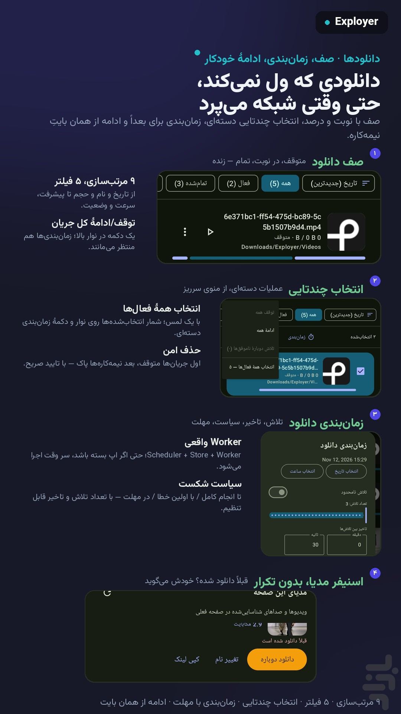
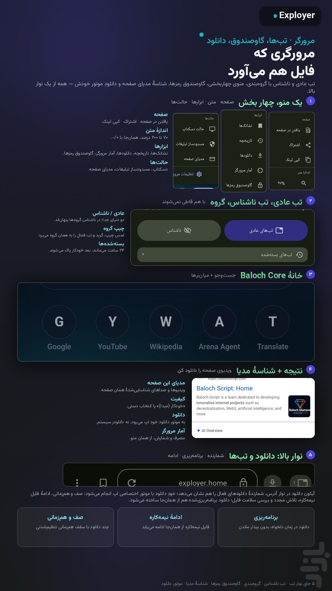
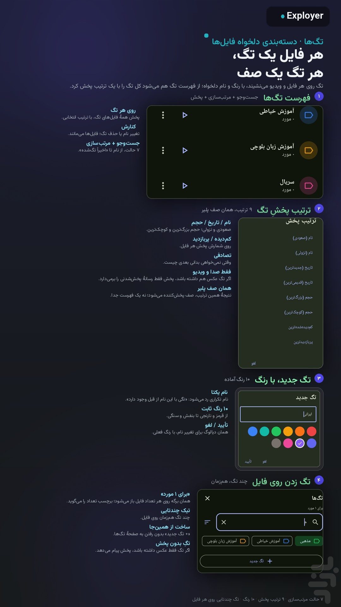
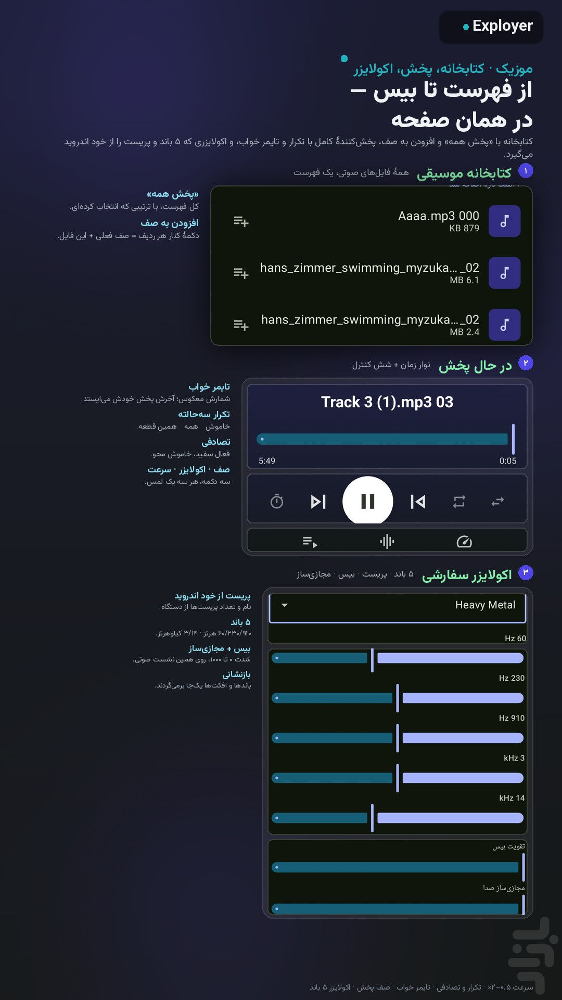
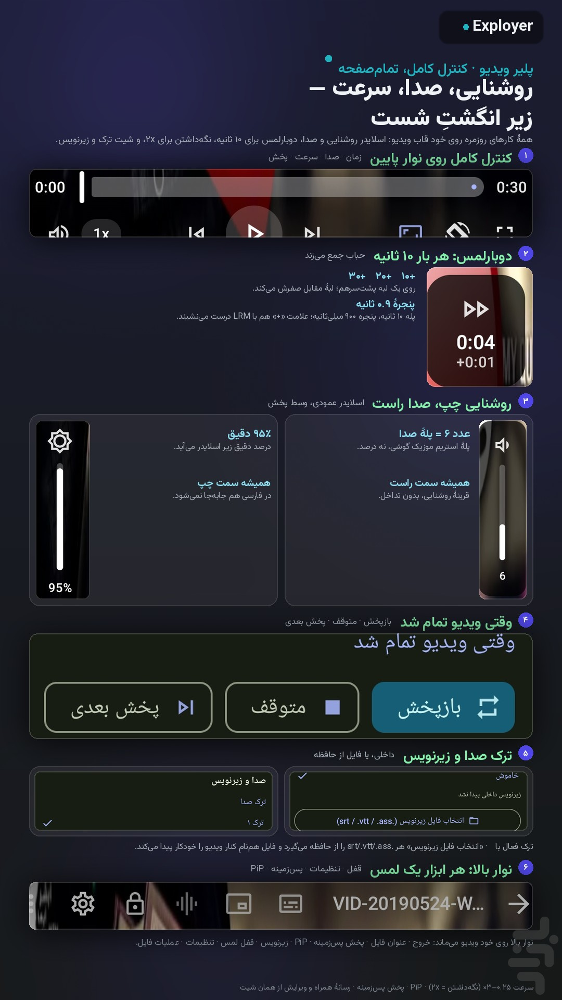
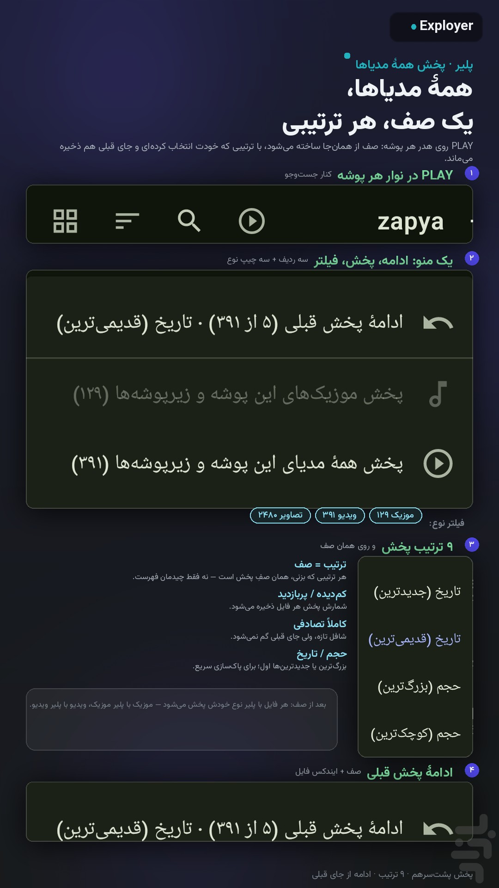
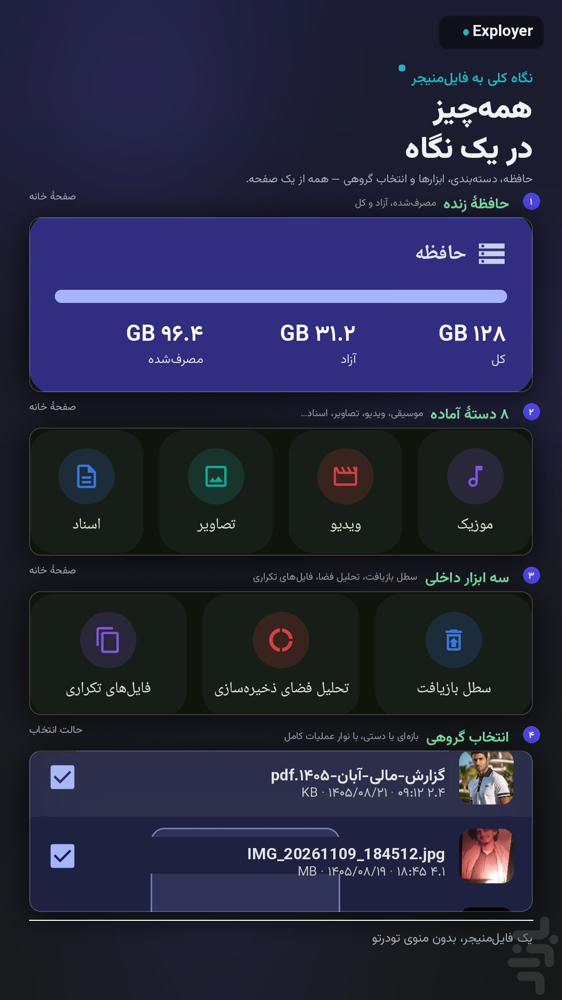

<div dir="rtl">

<p align="center">
  
</p>

<h1 align="center">Exployer — مدیر فایل، دانلودر ویدیو، مرورگر و ادیتور عکس اندروید</h1>

<p align="center">
  <b>یک APK رایگان به‌جای پنج اپ.</b><br>
  مدیر فایل با سطل زباله و تگ · پخش‌کنندهٔ موزیک و ویدیو با پخش هوشمندِ پوشه · مرورگر با اد-بلاکر ·
  دانلودر ویدیوی HLS/DASH · ادیتور عکس و ویدیو · بازکنندهٔ ZIP · گاوصندوق AES-256
</p>

<p align="center">
  <a href="https://github.com/balochscript/Exployer-App/releases/latest"></a>
  
  
  
</p>

<p align="center">
  <a href="https://github.com/balochscript/Exployer-App/releases/latest/download/exployer-0.9.103.apk"><b>⬇ دانلود APK (۹٫۱ مگابایت)</b></a>
  ·
  <a href="docs/FEATURES.md">همهٔ ویژگی‌ها (انگلیسی)</a>
  ·
  <a href="CHANGELOG.md">تغییرات نسخه‌ها</a>
  ·
  <a href="FAQ.md">پرسش‌های متداول</a>
  ·
  <a href="#تأیید-اصالت">تأیید هش</a>
</p>

<p align="center">
  <b>خواندن به زبان‌های دیگر:</b>
  <a href="README.md">English</a> ·
  <a href="README.fa.md">فارسی</a> ·
  <a href="README.es.md">Español</a> ·
  <a href="README.pt-BR.md">Português (BR)</a> ·
  <a href="README.id.md">Bahasa Indonesia</a> ·
  <a href="README.hi.md">हिन्दी</a> ·
  <a href="README.ar.md">العربية</a> ·
  <a href="README.ur.md">اردو</a>
</p>

---

## دو بیلد، همان امکانات

| فایل | حجم | کِی استفاده کنم |
|---|---|---|
| `exployer-0.9.103.apk` | **۹٫۱ مگابایت** | انتخاب معمولی. با R8 بهینه و کوچک شده؛ همان امکانات و همان رفتار. |
| `exployer-0.9.103-nor8.apk` | **۱۸٫۰ مگابایت** | فقط جایگزین اضطراری. همان کد بدون بهینه‌سازی R8 — اگر بیلد کوچک روی دستگاهی نامتعارف درست کار نکرد. |

هر دو فایل با یک کلید امضا شده‌اند و می‌توانند جای هم نصب شوند. هر دو versionCode **113**.

---

## اسکرین‌شات‌ها

این همان هفت تصویری است که در فهرست کافه‌بازار اپ دیده می‌شود:

| | | | |
|---|---|---|---|
|  |  |  |  |
| **دانلودها** | **مرورگر** | **تگ‌ها** | **موزیک** |
|  |  |  | |
| **پخش ویدیو** | **پخش پوشه** | **فایل‌منیجر** | |

هر هفت تصویر ۱۰۸۰×۱۹۲۰ هستند؛ ست انگلیسی همین برگه‌هاست و در
[README انگلیسی](README.md) و [docs/screenshots/README.md](docs/screenshots/README.md) توضیح داده شده.

---

## Exployer چیست؟

Exployer یک اپ اندرویدی است که کارهای روزمره‌ای را که مردم معمولاً برایشان پنج اپ نصب می‌کنند پوشش می‌دهد.
برای گوشی‌هایی بدون حساب گوگل‌پلی، بدون روت و بدون ثبت‌نام ساخته شده: APK را نصب کنید،
یک‌بار دسترسی «همهٔ فایل‌ها» را بدهید و همه‌چیز روی خود دستگاه اجرا می‌شود.

هیچ ابری، هیچ آپلودی و هیچ تله‌متری‌ای وجود ندارد. فایل‌ها، تاریخچهٔ پخش، تگ‌ها و گاوصندوق هرگز
گوشی را ترک نمی‌کنند.

## ویژگی‌ها

فهرست کامل با جزئیات هر بند در [docs/FEATURES.md](docs/FEATURES.md) (انگلیسی) است.
این هم فهرست کامل — ویژگی‌های بزرگ و کوچک:

### مدیر فایل
- حافظهٔ داخلی و کارت SD، نمای فهرستی و شبکه‌ای، مسیرِ قابل‌لمس برای پرش به هر پوشه
- مرتب‌سازی بر اساس نام، تاریخ، حجم یا نوع، در هر دو جهت؛ جستجوی سراسری در کل حافظه
- انتخاب تکی، چندتایی و بازه‌ای («از اول تا آخر»)؛ کپی، انتقال، حذف، تغییرنام، اشتراک، مشخصات
- شیت کپی/انتقال با مسیرِ خودش، ساخت پوشهٔ نو، نمایش فایل‌های مخفی
- هشت دسته — صدا، ویدیو، تصاویر، اسناد، دانلودها، APKها، آرشیوها، همهٔ فایل‌ها — به‌اضافهٔ کارت زندهٔ حافظه
  (اشغال/آزاد/کل) در صفحهٔ خانگی
- فایل‌های اخیر (۵ روز اخیر) با فیلتر نوع، «بازکردن پوشهٔ مادر» و مشخصات؛ اگر حافظه بزرگ‌تر از اندازهٔ
  اسکن باشد صادقانه می‌گوید
- زیپ‌کردن، رمزگذاری به `.enx`، رمزگشایی و نصب APK از همان فهرست
- نمایشگر داخلی PDF و متن، تا سند مجبور به خروج از اپ نشود
- سطل زباله: فایل‌های حذف‌شده تا ۳۰ روز قابل بازیابی‌اند، با شمارش معکوس
- تحلیل حافظه: بزرگ‌ترین پوشه‌ها و فایل‌ها، تفکیک بر اساس نوع (شامل فایل‌های تورنت)؛ یابِ فایل تکراری
  که کپی‌های اضافه را به سطل زباله می‌برد

### تگ‌ها
- تگ‌زدن هر فایل همان‌جا که می‌بینیدش — از فهرست فایل‌ها (لمس طولانی → انتخاب → دکمهٔ تگ در نوار انتخاب)،
  از Now Playing یا از ویوئر عکس/ویدیو. هیچ سقفی برای تعداد تگِ یک فایل وجود ندارد
- تگ دسته‌جمعی: چند فایل را انتخاب و با یک عمل تگ بزنید؛ اگر بخشی از انتخاب قبلاً تگ را داشته باشد
  پیکر «۳ از ۵» نشان می‌دهد و چیپ‌ها حالت همه/بعضی/هیچ را نشان می‌دهند
- ده رنگ که خودکار به تگ‌های نو اختصاص می‌یابند؛ ساخت (حتی از داخل پیکر)، تغییرنام، حذف — حذف تگ
  هرگز فایل‌ها را حذف نمی‌کند و دیالوگ همین را می‌گوید
- نام تگ تکراری رد می‌شود (حروف عربی/فارسیِ شبیه هم اول یکسان‌سازی می‌شوند)
- جستجو داخل فهرست تگ‌ها؛ پنج ترتیب: بیشترین آیتم، کمترین آیتم، جدیدترین، قدیمی‌ترین، تگ‌شده‌های اخیر
- پخش یک تگ: فقط موزیک‌هایش یا همهٔ مدیایش، با همان نه ترتیب و همان ادامهٔ پخش
- **پخش چندتگی (MultiTagPlay)**: روی چند تگ لمس طولانی کنید و همه را به‌صورت یک صف پخش کنید؛ فایلی که
  به دو تگِ منتخب تعلق دارد یک‌بار پخش می‌شود، نه دو بار؛ «ادامهٔ پخش قبلی» و «انتخاب همه» به جستجوی
  فعلیِ تگ احترام می‌گذارند

### موزیک و ویدیو
- کتابخانه با نوسازی بی‌سروصدا، صف، «افزودن به صف»، سرعت پخش (۰٫۲۵× تا ۳×)، تایمر خواب با زمان
  باقی‌مانده، تکرار خاموش/همه/یکی، شافل
- اکولایزر با پریست‌ها، تقویت باس و ورچوآلایزر به‌اضافهٔ ریست؛ مینی‌پلیر همیشه‌روشن
- پخش پس‌زمینه با کنترل‌های نوتیفیکیشن؛ نوتیفیکیشن‌ها زبان اپ را دنبال می‌کنند
- پخش یک پوشهٔ کامل (با زیرپوشه‌ها، تا ۲۴ سطح و ۲۰٫۰۰۰ فایل — و اگر به سقف برسد صادقانه می‌گوید) در
  نه ترتیب: نام A→Z، نام Z→A، تاریخِ نو، تاریخِ کهن، حجمِ بیشتر، حجمِ کمتر، کم‌پخش‌شده‌ها، پربازده‌ها، رندومِ کامل
- چیپ‌های فیلتر نوع (موزیک/ویدیو/تصاویر) با شمارنده، قابل‌تعویض پیش از پخش
- «ادامهٔ پخش قبلی»: صف، ترتیب، فیلتر نوع و آیتمِ جاری برای هر پوشه/آرشیو/تگ/مجموعهٔ چندتگی ذخیره
  می‌شود — منو پیشنهاد می‌دهد «ادامه در ۷ از ۴۲ · کم‌بازده‌ها»
- شمارشِ پخش فقط پس از ۱۰ ثانیه یا ۲۵٪ پیشرفت انجام می‌شود؛ پس «کم‌بازده‌ها» معنای واقعی دارد
- پخش‌کنندهٔ ویدیو: کشیدن افقی برای سیک، کشیدن عمودی برای صدا و روشنایی، بازهٔ سیکِ سوایپی ۰٫۵ تا ۲۰٪،
  دوبارلمس برای توقف/پخش، نگه‌داشتن برای سرعت ۲×، قفل لمس، نسبت تصویر (جاگیردن/پرکردن/کشیدن)،
  انتخاب ترک صدا و زیرنویس، تمام‌صفحه بدون نوارهای سیستم، چرخش دستی، تصویر-در-تصویر، اسکرین‌شات
  یک‌لمسی، رفتارِ پایان ویدیو (دوباره/توقف/بعدی)، مدیای همراه، کراپ و تریم از داخل خود پلیر

### مرورگر (Baloch Core)
- رندر با Chromium سیستم؛ تب‌ها، مسدودسازی، حریم خصوصی و آمار، کد خودِ Exployer است
- تب‌ها، پیش‌نمایش تب‌ها، گروه‌های تب با هشت رنگ — کشیدن کارت تب روی چیپ گروه، با Undo؛ بستن یک گروه
  تب‌هایش را باز نگه می‌دارد و ۲۴ ساعت قابل بازگردانی‌اند
- تب‌های ناشناس (هیچ‌چیز نگه داشته نمی‌شود)، تب‌های بسته‌شده تا ۲۴ ساعت با بازگردانیِ یک‌لمسی، بازگردانی
  نشست با دقیقاً همان جای اسکرول
- نوار تب در پنج جایگاه (بالا، پایین، چپ، راست، مخفی)؛ تبِ فقط-فاوآیکون؛ نوار پایینی اختیاری
- اد-بلاکر با فهرست منتخب دامنه‌های تبلیغاتی به‌اضافهٔ پنهان‌کردن جایگاه تبلیغ؛ «ذخیرهٔ داده» تصاویر و
  ویدیوهای سنگین را تا زدن «بارگذاری همه» نگه می‌دارد (به‌صورت پیش‌فرض خاموش است)
- سوییچ اختیاری Do Not Track / Sec-GPC (پیش‌فرض خاموش)؛ پاک‌کردن تاریخچه/کش/کوکی هنگام خروج
- صفحهٔ خانگی با میانبرهای قابل‌ویرایش، الگوی موتور جستجوی سفارشی، Find in page، زومِ به‌یادماندنیِ
  هر سایت، حالت دسکتاپ، اندازهٔ متن پیش‌فرض، نشانگر HTTPS/HTTP
- بوک‌مارک‌ها، تاریخچه، آمار مرورگر (بازدید و دانلودِ کل و هفتگی، پربازدیدترین سایت‌ها)
- مجوزِ دوربین/میکروفون/موقعیت به‌ازای هر سایت (پرسش/اجازه/رد) با صفحهٔ مدیریت
- شناساگر مدیا: حباب شناورِ قابل‌کشیدن یا آیکون نوار آدرس، هر ویدیو و صدای صفحهٔ فعلی را با حجم دقیق
  فهرست می‌کند — مالِ همان صفحه است، پس صفحهٔ بعدی رکوردهای کهنه را قاطی نمی‌کند؛ تغییرنام پیش از
  دانلود، کپی لینک مستقیم، اسکن دوباره

### دانلودها
- صف با درصد، سرعت، حجم، زمانِ remaining و جای در صف؛ هم‌زمان ۱ تا ۱۵ فایل یا بدون سقف
- ادامه از دقیقاً همان بایت (درخواست Range، نه شروع از صفر)
- ۳ تا ۳۰ ریترای خودکار (یا بی‌نهایت) با تأخیر سفارشیِ اختیاری؛ سیاستِ توقف تعیین می‌کند موتور ادامه
  بدهد، در اولین خطا بایستد یا در ددلاین بایستد
- دانلود زمان‌بندی‌شده: تاریخ، ساعت، تعداد ریترا، تأخیر، سیاست توقف و ددلاین؛ زمان‌بندی‌ها از کشته‌شدن
  اپ و ریبوت جان سالم به‌در می‌برند
- تشخیص «قبلاً دانلود شده» و «قبلاً در صف است»؛ تأیید checksum واقعیِ فایلِ تمام‌شده
- پیام‌های خطای صادقانه: محافظت‌شده با DRM، ۴۰۳/۴۰۴، صفحهٔ HTML به‌جای فایل (ضدلیچ)، شبکه، پرشدن
  حافظه، شکست تبدیل، رسیدن به ددلاین — هر کدام با قدم بعدی
- پشتیبانی HLS (M3U8) و DASH، مسیر جایگزین ضبط، پوشهٔ دانلود سفارشی (پیش‌فرض `Downloads/Exployer`)
- توقف/ادامهٔ همه با هم، توقف/شروع/ریترا/بازکردن/اشتراک/حذف هر آیتم، انتخاب دسته‌جمعی، پاک‌کردن فهرست
  تمام‌شده‌ها، تب‌های همه/فعال/زمان‌بندی‌شده، مرتب‌سازی بر اساس پیشرفت/سرعت/وضعیت
- نوتیفیکیشن دانلود با پیشرفت و کنترل در حالی که اپ بسته است

### ادیتور عکس و ویدیو
- کراپِ آزاد با نمایش سایز پیکسلی خروجی، چرخش
- هشت اسلایدر نور و رنگ: اکسپوژر، کنتراست، هایلایت، سایه، اشباع، وایبرانس، دما، تینت
- کِرِ تونال با نقاط آزاد به‌اضافهٔ کِرِهای آماده؛ شش فیلتر
- قلم‌موی هیل با سایز قابل‌تنظیم و Undo آخرین حرکت؛ اصلاح پرسپکتیو با کشیدن چهار گوشه
- Undo و Redo؛ درفت خودکار تا خروج از ادیتور کار را از دست ندهید
- سه مقصد ذخیره: کنار اصل، `Download/Exployer/Edit`، یا جایگزینی اصل (نسخهٔ قبلی به سطل زباله می‌رود)
- ادیتور ویدیو: تریم، کراپ، چرخش، ادغام کلیپ‌ها با یکسان‌سازی ابعاد، خروجیِ پس‌زمینه با نوتیفیکیشن
  پیشرفت — ادیتور را ببندید و فایل همچنان ساخته می‌شود

### ZIP، رمزنگاری، حریم خصوصی
- پیمایش آرشیو مثل یک پوشه بدون استخراج؛ استخراج پوشهٔ فعلی یا یک فایل با پیشرفت بایتی؛ چسباندن فایل
  داخل آرشیو؛ محافظت Zip-Slip؛ باز شدنِ سریع آرشیوهای خیلی بزرگ؛ پخش مدیای داخل آرشیو با همان نه
  ترتیب (پیش از استخراج می‌پرسد)
- رمزنگاری `.enx`: AES-256-GCM تکه‌تکه با کلیدِ مشتق‌شده با PBKDF2، به‌اضافهٔ ظرفِ پوشهٔ رمزشده که پس
  از یک بار رمز مثل پوشهٔ معمولی باز و پیمایش می‌شود؛ فایل‌های قدیمیِ `.enc` هنوز باز می‌شوند
- گاوصندوق رمز: یک رمز اصلی که یک‌بار می‌سازید، ورودی‌هایی با سایت/نام‌کاربری/رمز/یادداشت، قفلِ فوری،
  تغییر رمز اصلی؛ رمز اصلی هرگز ذخیره نمی‌شود

### ظاهر، زبان و تبلیغات
- تمِ سیستم/روشن/تیره، پنج پالت رنگ تأکیدی
- هشت زبان: فارسی، انگلیسی، اسپانیایی، پرتغالی برزیل، اندونزیایی، هندی، عربی، اردو — مستقل از زبان
  گوشی و شامل نوتیفیکیشن‌ها؛ چیدمان کامل راست‌به‌چپ
- رایگان و با تبلیغ (تپسل): یک ویدیوی جایزه‌ایِ کامل ۲۴ ساعت تبلیغ‌ها را خاموش می‌کند، پنج ویدیو در
  همان ۲۴ ساعت یک هفته؛ شمارنده پیش از ریست هشدار می‌دهد

## نصب

1. `exployer-0.9.103.apk` (۹٫۱ مگابایت) را از پنل [Releases](https://github.com/balochscript/Exployer-App/releases/latest) دانلود کنید.
2. روی گوشی بازش کنید. اگر اندروید پرسید، نصب از این منبع را اجازه دهید (مرورگر یا فایل‌منیجر شما).
3. Exployer را باز کنید و دسترسی **همهٔ فایل‌ها** را بدهید — همان دسترسی‌ای که یک مدیر فایل لازم دارد.
4. اختیاری: «نصب اپ‌های ناشناس» را فقط اگر می‌خواهید از داخل اپ APK نصب کنید اجازه دهید.

Exployer ۰.۹٫۱۰۳ · versionCode 113 · پکیج `com.balochscript.exployer` · اندروید ۸.۰ (API 26)+ ·
targetSdk 36 · ۹٫۱ مگابایت (بیلد R8) یا ۱۸٫۰ مگابایت (بدون R8)

## تأیید اصالت

SHA-256 فایلی که دانلود کردید را با مقدار زیر مقایسه کنید. هر ریلیز با همان کلید امضا می‌شود؛ پس
فایلِ ناهمسان در به‌روزرسانی هم از سوی اندروید رد می‌شود.

```
SHA-256 (exployer-0.9.103.apk)       6bd897b87cb9cabc527c4fe6d5295fe086303bfd5d2d684d1d4e334f1779e7ca
SHA-256 (exployer-0.9.103-nor8.apk)  d53f6480bc5516123b94c595f80244a0eece17fb84816edc35c15e80ed38436d
```

```bash
# ویندوز
certutil -hashfile exployer-0.9.103.apk SHA256
# لینوکس / مک
shasum -a 256 exployer-0.9.103.apk
# اندروید (Termux)
sha256sum exployer-0.9.103.apk
```

## چه چیزهایی نمی‌کند

صریح می‌گوییم تا کسی به اشتباه دانلود نکند:

- استریم‌های محافظت‌شده با DRM را نمی‌تواند دانلود کند و لاگین یا پی‌وال را دور نمی‌زند
- آرشیو ZIP رمزدار را نمی‌تواند باز کند
- سینک ابری، حساب کاربری و بکاپ بین‌دستگاهی ندارد
- اد-بلاکرش یک فهرست منتخب دامنه است، نه موتور اشتراکی به سبک uBlock

## پرسش‌های متداول

پاسخ‌های کوتاه اینجا، پاسخ‌های بلند در [FAQ.md](FAQ.md) (انگلیسی).

- **واقعاً رایگان است؟** بله. بدون حساب، بدون اشتراک؛ اپ با تبلیغ حمایت می‌شود و ویدیوهای جایزه‌ای
  خاموشش می‌کنند — یکی برای ۲۴ ساعت، پنج تا در همان ۲۴ ساعت برای یک هفته.
- **روت لازم دارد؟** نه. از دسترسی استاندارد «همهٔ فایل‌ها» استفاده می‌کند.
- **آفلاین کار می‌کند؟** مدیر فایل، پلیرها، ادیتور، ZIP و گاوصندوق بله. فقط مرورگر و دانلودر به شبکه
  نیاز دارند.
- **کدام نسخه‌های اندروید؟** ۸.۰ به بعد، شامل مجوزهای مدیای اندروید ۱۳ تا ۱۶.
- **چرا دو APK؟** یکی با R8 بهینه شده (۹٫۱ مگابایت)، دیگری همان کد بدون کوچک‌سازی (۱۸٫۰ مگابایت).

## حریم خصوصی

بدون حساب، بدون SDK آنالیتیکس، بدون آپلود. دوربین، میکروفون و موقعیت فقط به سایتی که خودتان باز
کرده‌اید و فقط پس از تأیید شما معرفی می‌شوند. جزئیات در [PRIVACY.md](PRIVACY.md) (انگلیسی).

## تغییرات نسخه‌ها

هر ریلیز و چه چیزهایی تغییر کرد، شامل فهرست کامل ۰.۹.۹۱ تا ۰.۹.۱۰۳: [CHANGELOG.md](CHANGELOG.md) (انگلیسی)

## پشتیبانی

- باگ و پیشنهاد: [ساخت Issue](https://github.com/balochscript/Exployer-App/issues)
- ایمیل: balochscriptcom@gmail.com
- وب‌سایت: [balochscript.com](https://balochscript.com)

<sub>Exployer ساختهٔ Baloch Script است. Android نشان تجاری Google LLC است؛ این پروژه وابسته به گوگل نیست.</sub>

</div>
