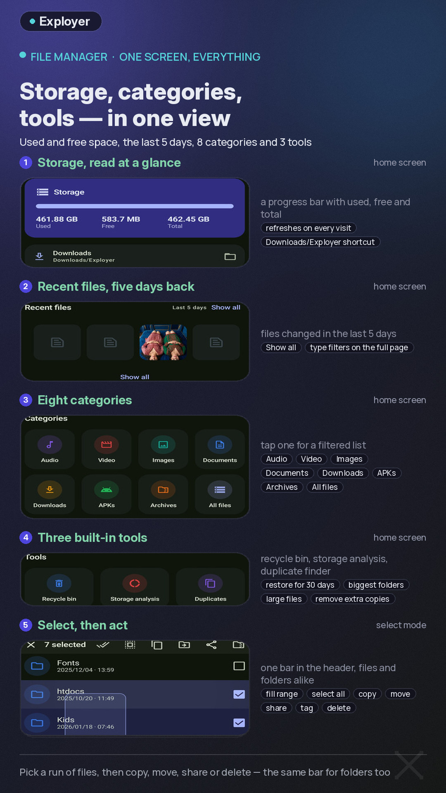
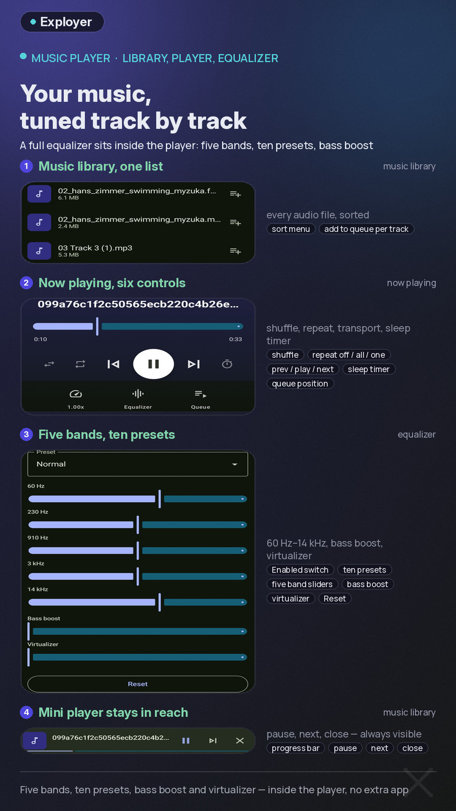

<p align="center">
  
</p>

<h1 align="center">Exployer — Android फ़ाइल मैनेजर, वीडियो डाउनलोडर, ब्राउज़र और फ़ोटो एडिटर</h1>

<p align="center">
  <b>पाँच ऐप्स की जगह एक मुफ़्त APK।</b><br>
  रिसायकल बिन और टैग वाला फ़ाइल मैनेजर · स्मार्ट फ़ोल्डर प्ले वाला म्यूज़िक और वीडियो प्लेयर · ऐड-ब्लॉकर वाला
  ब्राउज़र · HLS/DASH वीडियो डाउनलोडर · फ़ोटो और वीडियो एडिटर · ZIP रीडर · AES-256 वॉल्ट
</p>

<p align="center">
  <a href="https://github.com/balochscript/Exployer-App/releases/latest"></a>
  
  
  
</p>

<p align="center">
  <a href="https://github.com/balochscript/Exployer-App/releases/latest/download/exployer-0.9.103.apk"><b>⬇ APK डाउनलोड करें (9.1 MB)</b></a>
  ·
  <a href="docs/FEATURES.md">सभी फ़ीचर</a>
  ·
  <a href="CHANGELOG.md">बदलाव-लॉग</a>
  ·
  <a href="FAQ.md">सामान्य प्रश्न</a>
  ·
  <a href="#सत्यापन">हैश सत्यापन</a>
</p>

<p align="center">
  <b>इसे इन भाषाओं में पढ़ें:</b>
  <a href="README.md">English</a> ·
  <a href="README.fa.md">فارسی</a> ·
  <a href="README.es.md">Español</a> ·
  <a href="README.pt-BR.md">Português (BR)</a> ·
  <a href="README.id.md">Bahasa Indonesia</a> ·
  <a href="README.hi.md">हिन्दी</a> ·
  <a href="README.ar.md">العربية</a> ·
  <a href="README.ur.md">اردو</a>
</p>

---

## दो बिल्ड, एक ही फ़ीचर

| फ़ाइल | आकार | कब इस्तेमाल करें |
|---|---|---|
| `exployer-0.9.103.apk` | **9.1 MB** | सामान्य विकल्प। R8 से छोटा और अनुकूलित; वही फ़ीचर, वही व्यवहार। |
| `exployer-0.9.103-nor8.apk` | **18.0 MB** | केवल बैकअप। R8 मिनिफ़िकेशन के बिना वही कोड — अगर छोटा बिल्ड किसी असामान्य डिवाइस पर दिक्कत करे तो इसे इस्तेमाल करें। |

दोनों फ़ाइलें एक ही कुंजी से साइन हैं और एक-दूसरे पर अपडेट हो सकती हैं। दोनों versionCode **113** हैं।

---

## स्क्रीनशॉट

| | | | |
|---|---|---|---|
|  |  |  |  |
| **फ़ाइल मैनेजर** | **पूरा फ़ोल्डर चलाएँ** | **वीडियो प्लेयर** | **म्यूज़िक प्लेयर** |
|  |  |  | |
| **टैग** | **ब्राउज़र** | **डाउनलोड** | |

सातों चित्र 1080 × 1920 के हैं और फ़ारसी में भी मौजूद हैं — फ़ारसी सेट वही है जो ऐप की Cafe Bazaar
लिस्टिंग पर दिखता है। ये कैसे बनते हैं और कैप्शन क्या दावा करते हैं, यह [docs/screenshots/README.md](docs/screenshots/README.md) में बताया गया है।

---

## Exployer क्या है?

Exployer एक ही Android ऐप है जो रोज़मर्रा के वे काम करता है जिनके लिए लोग आमतौर पर पाँच ऐप्स इंस्टॉल करते
हैं। यह उन फ़ोनों के लिए बना है जिनमें Google Play अकाउंट नहीं है, रूट नहीं है और साइन-अप नहीं है: APK इंस्टॉल
करें, एक बार "All files access" की अनुमति दें, और सब कुछ डिवाइस पर ही चलता है।

कोई क्लाउड नहीं, कोई अपलोड नहीं, कोई टेलीमेट्री नहीं। फ़ाइलें, प्लेबैक हिस्ट्री, टैग और वॉल्ट कभी फ़ोन नहीं छोड़ते।

## फ़ीचर

पूरा कैटलॉग, हर बिंदु के पीछे के विवरण के साथ, [docs/FEATURES.md](docs/FEATURES.md) में है।
यहाँ पूरी सूची है — बड़े और छोटे फ़ीचर।

### फ़ाइल मैनेजर
- इंटरनल स्टोरेज और SD कार्ड, लिस्ट और ग्रिड व्यू, किसी भी फ़ोल्डर पर कूदने के लिए टैप करने योग्य ब्रेडक्रंब
- नाम, तारीख, आकार या प्रकार से दोनों दिशाओं में क्रम; पूरे स्टोरेज में वैश्विक खोज
- सिंगल, मल्टी-सिलेक्ट और रेंज सिलेक्ट ("पहले से आख़िरी"); कॉपी, मूव, डिलीट, रीनेम, शेयर, प्रॉपर्टीज़
- कॉपी/मूव शीट की अपनी ब्रेडक्रंब, नया फ़ोल्डर, छिपी फ़ाइलें
- आठ श्रेणियाँ — ऑडियो, वीडियो, इमेज, डॉक्युमेंट, डाउनलोड, APK, आर्काइव, सभी फ़ाइलें — और होम स्क्रीन पर लाइव स्टोरेज
  कार्ड (उपयोग / मुफ़्त / कुल)
- हाल की फ़ाइलें (पिछले पाँच दिन) अपने टाइप फ़िल्टर, ओपन-कंटेनिंग-फ़ोल्डर और प्रॉपर्टीज़ के साथ; स्टोरेज बहुत
  बड़ा होने पर पूरा स्कैन न हो सकने की ईमानदार सूचना
- ZIP में कंप्रेस, `.enx` में एन्क्रिप्ट, डिक्रिप्ट, उसी लिस्ट से APK इंस्टॉल
- बिल्ट-इन PDF और टेक्स्ट व्यूअर, ताकि डॉक्युमेंट को ऐप छोड़ना न पड़े
- रिसायकल बिन: डिलीट की गई फ़ाइलें 30 दिन तक रिकवर हो सकती हैं, काउंटडाउन के साथ
- स्टोरेज विश्लेषण: सबसे बड़े फ़ोल्डर और फ़ाइलें, प्रकार अनुसार विभाजन (टोरेंट फ़ाइलें समेत); डुप्लिकेट-फ़ाइल
  खोजक जो अतिरिक्त कॉपियाँ रिसायकल बिन में भेजता है

### टैग
- किसी फ़ाइल को देखते ही टैग करें — फ़ाइल लिस्ट से (लॉन्ग-प्रेस → सिलेक्ट → सिलेक्शन बार का टैग बटन), Now
  Playing से, या फ़ोटो/वीडियो व्यूअर से। एक फ़ाइल पर कितने भी टैग लग सकते हैं, कोई सीमा नहीं
- बल्क टैगिंग: कई फ़ाइलें चुनें और एक कार्रवाई में टैग लगाएँ; जब सिलेक्शन का कुछ हिस्सा ही टैग रखता हो तो
  पिकर "3 of 5" दिखाता है, और चिप्स all / some / none दिखाते हैं
- दस रंग, नए टैग पर अपने-आप लगे; बनाना (पिकर के अंदर से भी), रीनेम, डिलीट — टैग हटाने से फ़ाइलें कभी नहीं
  जातीं, डायलॉग यही कहता है
- डुप्लिकेट टैग नाम रद्द होते हैं (मिलते-जुलते अरबी/फ़ारसी अक्षर पहले सामान्य किए जाते हैं)
- टैग लिस्ट में खोज; पाँच क्रम: सबसे अधिक आइटम, सबसे कम आइटम, नवीनतम, पुरानतम, हाल में टैग किए गए
- पूरा टैग चलाएँ: उसका सिर्फ़ म्यूज़िक या उसका पूरा मीडिया, वही नौ क्रम और वही रिज़्यूम
- **MultiTagPlay**: कई टैग पर लॉन्ग-प्रेस करें और उनका सारा कंटेंट एक ही क्यू की तरह चलाएँ; दो चुने हुए टैगों
  में शामिल कोई फ़ाइल एक बार चलती है, दो बार नहीं; "पिछला प्लेबैक जारी रखें" और "सब चुनें" वर्तमान टैग-खोज का
  सम्मान करते हैं

### म्यूज़िक और वीडियो
- साइलेंट रिफ़्रेश वाली लाइब्रेरी, क्यू, "क्यू में जोड़ें", प्लेबैक स्पीड (0.25×–3.0×), शेष समय के साथ स्लीप
  टाइमर, रिपीट ऑफ़ / ऑल / वन, शफ़ल
- प्रीसेट, बेस बूस्ट और वर्चुअलाइज़र वाला इक्वलाइज़र, रीसेट सहित; हमेशा दिखने वाला मिनी प्लेयर
- नोटिफ़िकेशन कंट्रोल के साथ बैकग्राउंड प्लेबैक; नोटिफ़िकेशन ऐप की भाषा अपनाते हैं
- पूरा फ़ोल्डर चलाएँ (सबफ़ोल्डर सहित, 24 स्तर और 20,000 फ़ाइलों तक — और सीमा वास्तव में छिड़ने पर बताता है)
  नौ क्रम में: नाम A→Z, नाम Z→A, नई तारीख, पुरानी तारीख, बड़ा आकार, छोटा आकार, कम चली, अधिक चली, पूरा रैंडम
- काइंड फ़िल्टर चिप्स (म्यूज़िक / वीडियो / इमेज) गिनती के साथ, प्ले दबाने से पहले बदले जा सकते हैं
- "पिछला प्लेबैक जारी रखें": क्यू, क्रम, काइंड फ़िल्टर और मौजूदा आइटम हर फ़ोल्डर, आर्काइव, टैग और मल्टी-टैग
  सेट के लिए सहेजे जाते हैं — मेनू "7 of 42 · least played पर जारी रखें" देता है
- कोई प्ले केवल 10 सेकंड या 25 % प्रगति के बाद गिना जाता है, ताकि "least played" का असली अर्थ हो
- वीडियो प्लेयर: सीक के लिए क्षैतिज ड्रैग, वॉल्यूम-ब्राइटनेस के लिए लंबवत ड्रैग, 0.5–20 % स्वाइप-सीक रेंज,
  डबल-टैप पॉज़/प्ले, 2× के लिए दबाए रखें, टच लॉक, आस्पेक्ट रेशियो (फ़िट / क्रॉप / स्ट्रेच), ऑडियो और सबटाइटल
  ट्रैक चयन, सिस्टम बार के बिना फ़ुलस्क्रीन, मैनुअल रोटेशन, पिक्चर-इन-पिक्चर, एक-टैप स्क्रीनशॉट, वीडियो के अंत का
  व्यवहार (रिप्ले / स्टॉप / अगला), कंपैनियन मीडिया, प्लेयर से ही क्रॉप और ट्रिम

### ब्राउज़र (Baloch Core)
- रेंडरिंग सिस्टम Chromium WebView से; टैब, ब्लॉकिंग, प्राइवेसी और आँकड़े Exployer का अपना कोड हैं
- टैब, टैब प्रीव्यू, आठ रंगों के टैब ग्रुप — टैब कार्ड को ग्रुप चिप पर खींचें, अनडू के साथ; ग्रुप बंद करने पर
  उसके टैब खुले रहते हैं और 24 घंटे तक पुनर्प्राप्त रहते हैं
- इनकॉग्निटो टैब (कुछ नहीं रखा जाता), बंद टैब 24 घंटे तक पुनर्प्राप्त, सटीक स्क्रॉल स्थिति के साथ सेशन रिस्टोर
- पाँच स्थानों में टैब बार (ऊपर, नीचे, बाएँ, दाएँ, छिपा); केवल-फ़ेविकॉन टैब; वैकल्पिक बॉटम बार
- क्यूरेटेड डोमेन लिस्ट से ऐड ब्लॉकिंग और ऐड-स्लॉट छिपाना; डेटा सेवर भारी इमेज और वीडियो को "Load all" दबाने
  तक रोके रखता है (डिफ़ॉल्ट रूप से बंद)
- वैकल्पिक Do Not Track / Sec-GPC स्विच (डिफ़ॉल्ट रूप से बंद); बाहर जाते समय हिस्ट्री, कैश और कुकीज़ साफ़
- एडिट करने योग्य शॉर्टकट वाला होम पेज, कस्टम सर्च-इंजन पैटर्न, फ़ाइंड-इन-पेज, याद रखने योग्य पर-साइट ज़ूम,
  डेस्कटॉप मोड, डिफ़ॉल्ट टेक्स्ट साइज़, HTTPS/HTTP सूचक
- बुकमार्क, हिस्ट्री, ब्राउज़र आँकड़े (कुल और साप्ताहिक विज़िट और डाउनलोड, सबसे अधिक देखे गए साइट)
- प्रति-साइट कैमरा, माइक्रोफ़ोन और लोकेशन अनुमति (पूछें / अनुमति / अस्वीकार) प्रबंधन स्क्रीन के साथ
- मीडिया स्निफ़र: खींचने योग्य फ़्लोटिंग बबल या एड्रेस-बार आइकन वर्तमान पेज की हर वीडियो और ऑडियो स्ट्रीम को
  उसके सटीक आकार के साथ सूचीबद्ध करता है — प्रति पेज, इसलिए अगला पेज पुरानी स्ट्रीम को मिलाता नहीं; डाउनलोड
  से पहले रीनेम, सीधा लिंक कॉपी करें, दोबारा स्कैन

### डाउनलोड
- प्रतिशत, गति, आकार, शेष समय और क्यू-स्थिति के साथ क्यू; एक बार में 1–15 फ़ाइलें, या असीमित
- सटीक बाइट से फिर से शुरू (Range अनुरोध, रीस्टार्ट नहीं)
- 3–30 ऑटोमैटिक रीट्राई (या असीमित), वैकल्पिक कस्टम देरी के साथ; स्टॉप पॉलिसी तय करती है कि इंजन चुस्ती जारी
  रखे, पहली त्रुटि पर रुके या डेडलाइन पर रुके
- शेड्यूल्ड डाउनलोड: तारीख, समय, रीट्राई संख्या, देरी, स्टॉप पॉलिसी और डेडलाइन; शेड्यूल ऐप के बंद होने और
  रीबूट से बच जाते हैं
- "पहले ही डाउनलोड है" और "क्यू में पहले से है" पहचान; पूरी हुई फ़ाइल का वास्तविक checksum सत्यापन
- ईमानदार एरर संदेश: DRM-संरक्षित, 403/404, फ़ाइल की जगह HTML पेज (एंटी-लीच), नेटवर्क, स्टोरेज भरा,
  कन्वर्ज़न विफलता, डेडलाइन पूरी — हर एक के साथ अगला क़दम
- HLS (M3U8) और DASH समर्थन, कैप्चर फ़ॉलबैक, कस्टम डाउनलोड फ़ोल्डर (डिफ़ॉल्ट `Downloads/Exployer`)
- सब कुछ एक साथ रोकें/जारी रखें, प्रति-आइटम पॉज़/स्टार्ट/रीट्राई/ओपन/शेयर/डिलीट, बैच सिलेक्शन, पूरी सूची साफ़,
  All / Active / Scheduled टैब, प्रगति/गति/स्थिति से क्रम
- ऐप बंद होने पर भी प्रगति और कंट्रोल वाले डाउनलोड नोटिफ़िकेशन

### फ़ोटो और वीडियो एडिटर
- आउटपुट पिक्सेल आकार दिखाते हुए मुफ़्त क्रॉप, घुमाएँ
- आठ लाइट और कलर स्लाइडर: एक्सपोज़र, कंट्रास्ट, हाइलाइट्स, शैडोज़, सैचुरेशन, वाइब्रेंस, टेम्परेचर, टिंट
- मुफ़्त नियंत्रण बिंदुओं वाला टोन कर्व, तैयार कर्व सहित; छह फ़िल्टर
- आकार बदलने योग्य हील ब्रश, अंतिम स्ट्रोक अनडू; चार कोने खींचकर पर्सपेक्टिव सुधार
- अनडू और रीडू; ऑटोमैटिक ड्राफ़्ट, ताकि एडिटर छोड़ने पर काम न खोए
- तीन सेव गंतव्य: ओरिजिनल के पास, `Download/Exployer/Edit`, या ओरिजिनल बदलें (पुरानी कॉपी रिसायकल बिन जाती है)
- वीडियो एडिटर: ट्रिम, क्रॉप, रोटेट, आयाम-सामान्यीकरण के साथ क्लिप मर्ज, प्रगति नोटिफ़िकेशन के साथ बैकग्राउंड
  एक्सपोर्ट — एडिटर बंद करें, फ़ाइल फिर भी बनती है

### ZIP, एन्क्रिप्शन, प्राइवेसी
- ZIP को बिना निकाले फ़ोल्डर की तरह खोलें; बाइट-आधारित प्रगति के साथ मौजूदा फ़ोल्डर या एक फ़ाइल निकालें;
  ZIP के अंदर फ़ाइलें पेस्ट करें; Zip-Slip सुरक्षा; बहुत बड़े ZIP तेज़ी से खुलते हैं; ZIP के अंदर का मीडिया वही
  नौ क्रमों में चलता है (निकालने से पहले पूछता है)
- `.enx` एन्क्रिप्शन: PBKDF2 से कुंजी वाला चंक्ड AES-256-GCM, साथ में एन्क्रिप्टेड फ़ोल्डर कंटेनर जो एक
  पासवर्ड के बाद सामान्य फ़ोल्डर की तरह खुलता और घुमता है; पुरानी `.enc` फ़ाइलें अब भी खुलती हैं
- पासवर्ड वॉल्ट: एक बार बनाया मास्टर पासवर्ड, साइट / यूज़रनेम / पासवर्ड / नोट वाली एंट्री, तुरंत लॉक,
  मास्टर-पासवर्ड बदलना; मास्टर पासवर्ड कभी स्टोर नहीं होता

### लुक, भाषा और विज्ञापन
- सिस्टम / लाइट / डार्क थीम, पाँच एक्सेंट पैलेट
- आठ भाषाएँ: फ़ारसी, अंग्रेज़ी, स्पेनिश, ब्राज़ीलियन पुर्तगाली, इंडोनेशियाई, हिन्दी, अरबी, उर्दू — फ़ोन की
  भाषा से स्वतंत्र, नोटिफ़िकेशनों पर भी लागू; पूर्ण दाएँ-से-बाएँ लेआउट
- मुफ़्त और विज्ञापनों से संचालित (Tapsell): एक पूरा रिवॉर्डेड वीडियो 24 घंटे के लिए विज्ञापन बंद करता है, उन्हीं
  24 घंटों में पाँच वीडियो एक सप्ताह के लिए; काउंटर रीसेट से पहले चेताता है

## इंस्टॉल

1. [Releases](https://github.com/balochscript/Exployer-App/releases/latest) पैनल से `exployer-0.9.103.apk` (9.1 MB) डाउनलोड करें।
2. फ़ोन पर खोलें। यदि Android पूछे, तो इस स्रोत से इंस्टॉल करने की अनुमति दें (आपका ब्राउज़र या फ़ाइल मैनेजर)।
3. Exployer खोलें और **All files access** दें — यही अनुमति एक फ़ाइल मैनेजर को चाहिए।
4. वैकल्पिक: "unknown apps इंस्टॉल करें" की अनुमति केवल तब दें जब ऐप के अंदर से APK इंस्टॉल करना हो।

Exployer 0.9.103 · versionCode 113 · पैकेज `com.balochscript.exployer` · Android 8.0 (API 26)+ ·
targetSdk 36 · 9.1 MB (R8 बिल्ड) या 18.0 MB (no-R8)

## सत्यापन

डाउनलोड की गई फ़ाइल का SHA-256 नीचे दिए मान से मिलाएँ। हर रिलीज़ एक ही कुंजी से साइन है, इसलिए छेड़ी हुई
फ़ाइल को Android अपडेट पर भी रद्द कर देगा।

```
SHA-256 (exployer-0.9.103.apk)       6bd897b87cb9cabc527c4fe6d5295fe086303bfd5d2d684d1d4e334f1779e7ca
SHA-256 (exployer-0.9.103-nor8.apk)  d53f6480bc5516123b94c595f80244a0eece17fb84816edc35c15e80ed38436d
```

```bash
# Windows
certutil -hashfile exployer-0.9.103.apk SHA256
# Linux / macOS
shasum -a 256 exployer-0.9.103.apk
# Android (Termux)
sha256sum exployer-0.9.103.apk
```

## यह क्या नहीं करता

साफ़ शब्दों में, ताकि कोई गलत कारण से डाउनलोड न करे:

- DRM-संरक्षित स्ट्रीम डाउनलोड नहीं कर सकता, और लॉगिन या पेवॉल को बायपास नहीं करता
- पासवर्ड-संरक्षित ZIP नहीं खोल सकता
- क्लाउड सिंक, अकाउंट या क्रॉस-डिवाइस बैकअप नहीं है
- ऐड ब्लॉकिंग एक क्यूरेटेड डोमेन लिस्ट है, uBlock-शैली का सब्सक्रिप्शन इंजन नहीं

## सामान्य प्रश्न

छोटे उत्तर यहाँ, विस्तृत उत्तर [FAQ.md](FAQ.md) में।

- **वाकई मुफ़्त है?** हाँ। अकाउंट नहीं, सब्सक्रिप्शन नहीं; ऐप विज्ञापनों से चलता है, और रिवॉर्डेड वीडियो उन्हें
  बंद कर देते हैं — एक वीडियो 24 घंटे के लिए, उन्हीं 24 घंटों में पाँच वीडियो एक सप्ताह के लिए।
- **रूट चाहिए?** नहीं। यह मानक All-files-access अनुमति उपयोग करता है।
- **ऑफ़लाइन चलता है?** फ़ाइल मैनेजर, प्लेयर, एडिटर, ZIP और वॉल्ट चलते हैं। केवल ब्राउज़र और डाउनलोडर को
  नेटवर्क चाहिए।
- **कौन से Android संस्करण?** 8.0 और नए, Android 13–16 की मीडिया अनुमतियों सहित।
- **दो APK क्यों?** एक R8 से अनुकूलित है (9.1 MB), दूसरा वही बिना-छोटा कोड (18.0 MB)।

## प्राइवेसी

अकाउंट नहीं, एनालिटिक्स SDK नहीं, अपलोड नहीं। कैमरा, माइक्रोफ़ोन और लोकेशन केवल उस साइट को दिखाए जाते हैं
जिसे आपने स्वयं खोला है और केवल आपकी स्वीकृति के बाद। विवरण [PRIVACY.md](PRIVACY.md) में।

## बदलाव-लॉग

हर रिलीज़ और क्या बदला, पूरी 0.9.91 → 0.9.103 सूची सहित: [CHANGELOG.md](CHANGELOG.md)

## सहायता

- बग और फ़ीचर अनुरोध: [issue खोलें](https://github.com/balochscript/Exployer-App/issues)
- ईमेल: balochscriptcom@gmail.com
- वेबसाइट: [balochscript.com](https://balochscript.com)

<sub>Exployer को Baloch Script ने बनाया है। Android Google LLC का ट्रेडमार्क है। यह प्रोजेक्ट Google से संबद्ध नहीं है।</sub>
