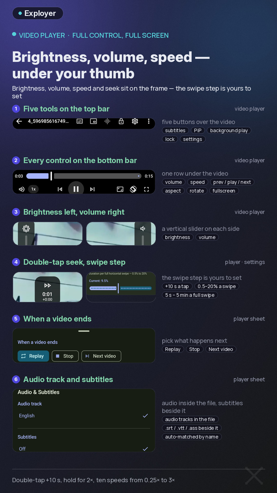
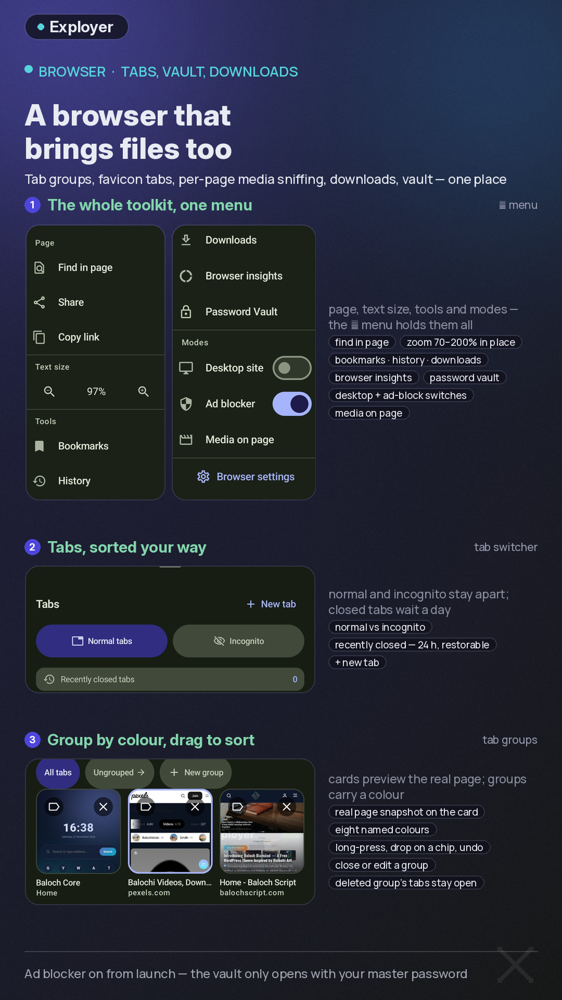

<p align="center">
  
</p>

<h1 align="center">Exployer — pengelola file, pengunduh video, peramban & editor foto Android</h1>

<p align="center">
  <b>Satu APK gratis sebagai pengganti lima aplikasi.</b><br>
  Pengelola file dengan tempat sampah dan tag · pemutar musik & video dengan pemutaran pintar per folder ·
  peramban dengan pemblokir iklan · pengunduh video HLS/DASH · editor foto dan video · pembaca ZIP · brankas AES-256
</p>

<p align="center">
  <a href="https://github.com/balochscript/Exployer-App/releases/latest"></a>
  
  
  
</p>

<p align="center">
  <a href="https://github.com/balochscript/Exployer-App/releases/latest/download/exployer-0.9.103.apk"><b>⬇ Unduh APK (9,1 MB)</b></a>
  ·
  <a href="docs/FEATURES.md">Semua fitur</a>
  ·
  <a href="CHANGELOG.md">Changelog</a>
  ·
  <a href="FAQ.md">FAQ</a>
  ·
  <a href="#verifikasi">Verifikasi hash</a>
</p>

<p align="center">
  <b>Baca dalam:</b>
  <a href="README.md">English</a> ·
  <a href="README.fa.md">فارسی</a> ·
  <a href="README.es.md">Español</a> ·
  <a href="README.pt-BR.md">Português (BR)</a> ·
  <a href="README.id.md">Bahasa Indonesia</a> ·
  <a href="README.hi.md">हिन्दी</a> ·
  <a href="README.ar.md">العربية</a> ·
  <a href="README.ur.md">اردو</a>
</p>

---

## Dua build, fitur yang sama

| File | Ukuran | Kapan digunakan |
|---|---|---|
| `exployer-0.9.103.apk` | **9,1 MB** | Pilihan normal. Diperkecil dan dioptimalkan dengan R8; fitur dan perilaku identik. |
| `exployer-0.9.103-nor8.apk` | **18,0 MB** | Hanya sebagai cadangan. Kode yang sama tanpa minifikasi R8 — pakai ini jika build kecil bermasalah di perangkat yang tidak biasa. |

Kedua file ditandatangani dengan kunci yang sama dan bisa saling memperbarui. Keduanya versionCode **113**.

---

## Tangkapan layar

| | | | |
|---|---|---|---|
|  |  |  |  |
| **Pengelola file** | **Putar seluruh folder** | **Pemutar video** | **Pemutar musik** |
|  |  |  | |
| **Tag** | **Peramban** | **Unduhan** | |

Semuanya berukuran 1080 × 1920 dan juga tersedia dalam bahasa Persi — set Persi adalah yang tampil di
daftar Cafe Bazaar aplikasi. Cara set ini dibuat dan apa yang diklaim keterangannya dijelaskan di
[docs/screenshots/README.md](docs/screenshots/README.md).

---

## Apa itu Exployer?

Exployer adalah satu aplikasi Android yang menangani pekerjaan sehari-hari yang biasanya membuat orang
memasang lima aplikasi. Dibuat untuk ponsel tanpa akun Google Play, tanpa root, dan tanpa pendaftaran:
pasang APK-nya, berikan izin "Akses semua file" sekali, dan semuanya berjalan di perangkat.

Tidak ada cloud, tidak ada unggahan, tidak ada telemetri. File, riwayat pemutaran, tag, dan brankas tidak
pernah keluar dari ponsel.

## Fitur

Katalog lengkap, dengan detail di balik setiap butir, ada di [docs/FEATURES.md](docs/FEATURES.md).
Ini daftar lengkapnya — fitur besar maupun kecil.

### Pengelola file
- Penyimpanan internal dan kartu SD, tampilan daftar dan kisi, breadcrumb yang bisa disentuh untuk lompat
  ke folder mana pun
- Urutkan berdasarkan nama, tanggal, ukuran, atau jenis, dua arah; pencarian global di seluruh penyimpanan
- Pilih satu, banyak, dan rentang ("dari pertama hingga terakhir"); salin, pindahkan, hapus, ganti nama,
  bagikan, properti
- Lembar salin/pindah dengan breadcrumb sendiri, buat folder, file tersembunyi
- Delapan kategori — audio, video, gambar, dokumen, unduhan, APK, arsip, semua file — plus kartu penyimpanan langsung
  (terpakai / bebas / total) di beranda
- File terbaru (lima hari terakhir) dengan filter jenis, buka-folder-asal, dan properti; memberi tahu secara
  jujur saat penyimpanan terlalu besar untuk dipindai sepenuhnya
- Kompres ke ZIP, enkripsi ke `.enx`, dekripsi, dan pasang APK langsung dari daftar
- Penampil PDF dan teks bawaan, sehingga dokumen tidak perlu keluar dari aplikasi
- Tempat sampah: file yang dihapus tetap bisa dipulihkan hingga 30 hari, dengan hitungan mundur
- Analisis penyimpanan: folder dan file terbesar, dipecah per jenis (termasuk file torrent); pencari file
  duplikat yang memindahkan salinan berlebih ke tempat sampah

### Tag
- Tandai file apa pun saat Anda melihatnya — dari daftar file (tekan lama → pilih → tombol tag di bilah
  seleksi), dari Now Playing, atau dari penampil foto/video. Tidak ada batas jumlah tag per file
- Penandaan massal: pilih banyak file dan terapkan satu tag dalam satu aksi; pemilih menampilkan "3 dari 5"
  saat hanya sebagian seleksi yang sudah memilikinya, dan chip menampilkan semua / sebagian / tidak ada
- Sepuluh warna, ditetapkan otomatis; buat (juga dari dalam pemilih), ganti nama, hapus — menghapus tag tidak
  pernah menghapus file, dialognya menyatakan begitu
- Nama tag duplikat ditolak (karakter Arab/Persia yang mirip dinormalisasi dulu)
- Pencarian di dalam daftar tag; lima urutan: terbanyak item, paling sedikit item, terbaru, terlama,
  baru saja ditandai
- Putar seluruh tag: hanya musiknya, atau semua medianya, dengan sembilan urutan yang sama dan kelanjutan
  yang sama
- **MultiTagPlay**: tekan lama beberapa tag lalu putar seluruh isinya sebagai satu antrean; file yang
  termasuk dua tag terpilih diputar sekali, bukan dua kali; "lanjutkan pemutaran sebelumnya" dan "pilih
  semua" menghormati pencarian tag saat ini

### Musik dan video
- Pustaka dengan penyegaran senyap, antrean, "tambahkan ke antrean", kecepatan pemutaran (0,25×–3,0×),
  timer tidur dengan sisa waktu, ulangi mati / semua / satu, acak
- Equalizer dengan preset, penambah bass, dan virtualizer, plus reset; mini player selalu terlihat
- Pemutaran latar belakang dengan kontrol notifikasi; notifikasi mengikuti bahasa aplikasi
- Putar seluruh folder (termasuk subfolder, hingga 24 tingkat dan 20.000 file — dan mengatakannya saat batas
  benar-benar tercapai) dalam sembilan urutan: nama A→Z, nama Z→A, tanggal terbaru, tanggal terlama, ukuran
  terbesar, ukuran terkecil, paling jarang diputar, paling sering diputar, acak penuh
- Chip filter jenis (musik / video / gambar) dengan hitungan, bisa diganti sebelum menekan putar
- "Lanjutkan pemutaran sebelumnya": antrean, urutan, filter jenis, dan item saat ini disimpan per folder,
  arsip, tag, dan set multi-tag — menu menawarkan "lanjut di 7 dari 42 · paling jarang diputar"
- Sebuah pemutaran hanya dihitung setelah 10 detik atau 25 % kemajuan, sehingga "paling jarang diputar"
  bermakna nyata
- Pemutar video: geser horizontal untuk mencari, vertikal untuk volume dan kecerahan, rentang geser-cari
  0,5–20 %, ketuk dua kali untuk jeda/putar, tahan untuk 2×, kunci sentuh, rasio aspek (pas / potong /
  regang), pemilihan trek audio dan subtitle, layar penuh tanpa bilah sistem, rotasi manual,
  picture-in-picture, tangkapan layar sekali ketuk, perilaku akhir video (ulangi / berhenti / berikutnya),
  media pendamping, potong dan pangkas langsung dari pemutar

### Peramban (Baloch Core)
- Perenderan oleh WebView Chromium sistem; tab, pemblokiran, privasi, dan statistik adalah kode milik
  Exployer sendiri
- Tab, pratinjau tab, grup tab dengan delapan warna — seret kartu tab ke chip grup, dengan urungkan;
  menutup grup menjaga tabnya tetap terbuka dan dapat dipulihkan selama 24 jam
- Tab penyamaran (tidak ada yang disimpan), tab yang ditutup dapat dipulihkan 24 jam, pemulihan sesi dengan
  posisi gulir yang tepat
- Bilah tab di lima posisi (atas, bawah, kiri, kanan, tersembunyi); tab hanya-favicon; bilah bawah opsional
- Pemblokiran iklan dengan daftar domain terkurasi plus penyembunyian slot iklan; penghemat data menahan
  gambar dan video berat sampai Anda menekan "Muat semua" (mati secara bawaan)
- Sakelar opsional Do Not Track / Sec-GPC (mati secara bawaan); bersihkan riwayat, cache, dan cookie saat keluar
- Beranda dengan pintasan yang bisa diedit, pola mesin pencari kustom, cari di halaman, zoom per situs yang
  bisa diingat, mode desktop, ukuran teks bawaan, indikator HTTPS/HTTP
- Bookmark, riwayat, statistik peramban (kunjungan dan unduhan total dan mingguan, situs paling sering dikunjungi)
- Izin kamera, mikrofon, dan lokasi per situs (tanya / izinkan / tolak) dengan layar pengelolaan
- Sniffer media: gelembung mengambang yang bisa diseret atau ikon di bilah alamat mendaftar setiap video dan
  audio di halaman saat ini dengan ukuran tepatnya — per halaman, jadi halaman berikutnya tidak mencampur
  stream lama; ganti nama sebelum mengunduh, salin tautan langsung, pindai ulang

### Unduhan
- Antrean dengan persentase, kecepatan, ukuran, sisa waktu, dan posisi antrean; 1–15 file sekaligus, atau tanpa batas
- Melanjutkan dari byte yang tepat (permintaan Range, bukan mulai dari nol)
- 3–30 percobaan otomatis (atau tanpa batas) dengan jeda kustom opsional; kebijakan berhenti menentukan apakah
  mesin terus mencoba, berhenti pada galat pertama, atau berhenti pada tenggat
- Unduhan terjadwal: tanggal, waktu, jumlah percobaan, jeda, kebijakan berhenti, dan tenggat; jadwal selamat
  dari aplikasi yang dimatikan dan reboot
- Deteksi "sudah diunduh" dan "sudah di antrean"; verifikasi checksum sungguhan atas file yang selesai
- Pesan galat yang jujur: dilindungi DRM, 403/404, halaman HTML sebagai ganti file (anti-leech), jaringan,
  penyimpanan penuh, kegagalan konversi, tenggat tercapai — masing-masing dengan langkah berikutnya
- Dukungan HLS (M3U8) dan DASH, fallback perekaman, folder unduhan kustom (bawaan `Downloads/Exployer`)
- Jeda atau lanjutkan semuanya sekaligus, jeda/mulai/ulangi/buka/bagikan/hapus per item, seleksi batch,
  bersihkan daftar yang selesai, tab Semua / Aktif / Terjadwal, urutkan berdasarkan kemajuan, kecepatan, atau status
- Notifikasi unduhan dengan kemajuan dan kontrol saat aplikasi tertutup

### Editor foto dan video
- Potong bebas dengan ukuran piksel keluaran ditampilkan, putar
- Delapan penggeser cahaya dan warna: exposure, kontras, highlight, bayangan, saturasi, vibrance,
  temperatur, tint
- Kurva tonal dengan titik bebas, plus kurva siap pakai; enam filter
- Kuas perbaikan dengan ukuran bisa diatur, urungkan goresan terakhir; koreksi perspektif dengan menyeret
  empat sudut
- Urungkan dan ulangi; draf otomatis agar keluar dari editor tidak membuat pekerjaan hilang
- Tiga tujuan simpan: di samping aslinya, `Download/Exployer/Edit`, atau ganti aslinya (salinan sebelumnya
  masuk ke tempat sampah)
- Editor video: pangkas, potong, putar, gabungkan klip dengan normalisasi dimensi, ekspor latar belakang
  dengan notifikasi kemajuan — tutup editor dan filenya tetap dibuat

### ZIP, enkripsi, privasi
- Jelajahi arsip seperti folder tanpa mengekstrak; ekstrak folder saat ini atau satu file dengan kemajuan
  per byte; tempel file ke dalam arsip; proteksi Zip-Slip; pembukaan cepat arsip sangat besar; putar media
  di dalam arsip dengan sembilan urutan yang sama (bertanya dulu sebelum mengekstrak)
- Enkripsi `.enx`: AES-256-GCM per blok dengan kunci turunan PBKDF2, plus kontainer folder terenkripsi yang
  terbuka dan bisa dijelajahi seperti folder biasa setelah satu kali kata sandi; file lama `.enc` tetap bisa dibuka
- Brankas kata sandi: kata sandi utama yang Anda tetapkan sekali, entri dengan situs / nama pengguna / kata
  sandi / catatan, kunci instan, ganti kata sandi utama; kata sandi utama tidak pernah disimpan

### Tampilan, bahasa, dan iklan
- Tema sistem / terang / gelap, lima palet warna aksen
- Delapan bahasa: Persia, Inggris, Spanyol, Portugis Brasil, Indonesia, Hindi, Arab, Urdu — independen dari
  bahasa ponsel, diterapkan juga ke notifikasi; tata letak kanan-ke-kiri penuh
- Gratis dan didukung iklan (Tapsell): satu video berhadiah penuh mematikan iklan 24 jam, lima video dalam 24
  jam itu mematikan selama seminggu; penghitung memberi peringatan sebelum direset

## Pemasangan

1. Unduh `exployer-0.9.103.apk` (9,1 MB) dari panel [Releases](https://github.com/balochscript/Exployer-App/releases/latest).
2. Buka di ponsel. Jika Android bertanya, izinkan pemasangan dari sumber ini (peramban atau pengelola file Anda).
3. Buka Exployer dan berikan **Akses semua file** — izin yang dibutuhkan sebuah pengelola file.
4. Opsional: izinkan "pasang aplikasi tidak dikenal" hanya jika Anda ingin memasang APK dari dalam aplikasi.

Exployer 0.9.103 · versionCode 113 · paket `com.balochscript.exployer` · Android 8.0 (API 26)+ ·
targetSdk 36 · 9,1 MB (build R8) atau 18,0 MB (tanpa R8)

## Verifikasi

Bandingkan SHA-256 file yang Anda unduh dengan nilai di bawah. Setiap rilis ditandatangani dengan kunci yang
sama, jadi file yang dimanipulasi juga akan ditolak Android saat pembaruan.

```
SHA-256 (exployer-0.9.103.apk)       6bd897b87cb9cabc527c4fe6d5295fe086303bfd5d2d684d1d4e334f1779e7ca
SHA-256 (exployer-0.9.103-nor8.apk)  d53f6480bc5516123b94c595f80244a0eece17fb84816edc35c15e80ed38436d
```

```bash
# Windows
certutil -hashfile exployer-0.9.103.apk SHA256
# Linux / macOS
shasum -a 256 exployer-0.9.103.apk
# Android (Termux)
sha256sum exployer-0.9.103.apk
```

## Yang tidak dilakukannya

Diucapkan terus terang, agar tidak ada yang mengunduh karena alasan yang salah:

- Tidak bisa mengunduh stream yang dilindungi DRM, dan tidak melewati login atau paywall
- Tidak bisa membuka arsip ZIP yang dilindungi kata sandi
- Tidak ada sinkronisasi cloud, akun, atau cadangan antarperangkat
- Pemblokir iklannya adalah daftar domain terkurasi, bukan mesin langganan ala uBlock

## FAQ

Jawaban singkat di sini, yang panjang di [FAQ.md](FAQ.md).

- **Benar-benar gratis?** Ya. Tanpa akun, tanpa langganan; aplikasi didukung iklan, dan video berhadiah
  mematikannya — satu untuk 24 jam, lima dalam 24 jam itu untuk seminggu.
- **Perlu root?** Tidak. Memakai izin standar akses semua file.
- **Berfungsi offline?** Pengelola file, pemutar, editor, ZIP, dan brankas bisa. Hanya peramban dan pengunduh
  yang butuh jaringan.
- **Versi Android apa?** 8.0 ke atas, termasuk izin media Android 13–16.
- **Kenapa dua APK?** Satu dioptimalkan dengan R8 (9,1 MB), yang lain kode sama tanpa pengecilan (18,0 MB).

## Privasi

Tanpa akun, tanpa SDK analitik, tanpa unggahan. Kamera, mikrofon, dan lokasi hanya diungkap ke situs yang
Anda buka sendiri dan hanya setelah Anda setujui. Detail di [PRIVACY.md](PRIVACY.md).

## Changelog

Setiap rilis dan apa yang berubah, termasuk daftar lengkap 0.9.91 → 0.9.103: [CHANGELOG.md](CHANGELOG.md)

## Dukungan

- Bug dan usulan fitur: [buka issue](https://github.com/balochscript/Exployer-App/issues)
- Email: balochscriptcom@gmail.com
- Situs web: [balochscript.com](https://balochscript.com)

<sub>Exployer dibuat oleh Baloch Script. Android adalah merek dagang Google LLC. Proyek ini tidak berafiliasi dengan Google.</sub>
