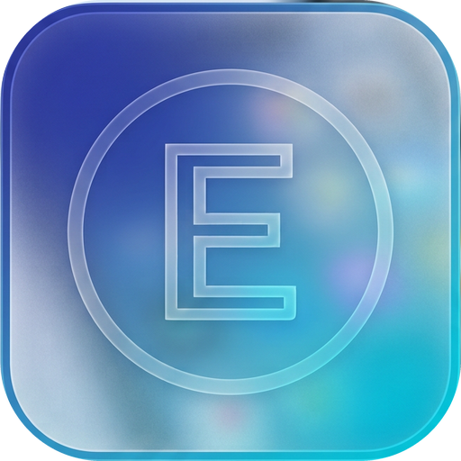

<p align="center">
  
</p>

<h1 align="center">Exployer — Android file manager, video downloader, browser &amp; photo editor</h1>

<p align="center">
  <b>One free APK instead of five apps.</b><br>
  File manager with a recycle bin and tags · music &amp; video player with smart folder play · browser with an
  ad blocker · HLS/DASH video downloader · photo and video editor · ZIP reader · AES-256 vault
</p>

<p align="center">
  <a href="https://github.com/balochscript/Exployer-App/releases/latest"></a>
  
  
  
</p>

<p align="center">
  <a href="https://github.com/balochscript/Exployer-App/releases/latest/download/exployer-0.9.103.apk"><b>⬇ Download the APK (9.1 MB)</b></a>
  ·
  <a href="docs/FEATURES.md">Every feature</a>
  ·
  <a href="CHANGELOG.md">Changelog</a>
  ·
  <a href="FAQ.md">FAQ</a>
  ·
  <a href="#verify">Verify the hash</a>
</p>

<p align="center">
  <b>Read this in:</b>
  <a href="README.md">English</a> ·
  <a href="README.fa.md">فارسی</a> ·
  <a href="README.es.md">Español</a> ·
  <a href="README.pt-BR.md">Português (BR)</a> ·
  <a href="README.id.md">Bahasa Indonesia</a> ·
  <a href="README.hi.md">हिन्दी</a> ·
  <a href="README.ar.md">العربية</a> ·
  <a href="README.ur.md">اردو</a>
</p>

---

## Two builds, same features

| File | Size | When to use it |
|---|---|---|
| `exployer-0.9.103.apk` | **9.1 MB** | Normal choice. Shrunk and optimised by R8; identical features and behaviour. |
| `exployer-0.9.103-nor8.apk` | **18.0 MB** | Fallback only. Same code without R8 minification — use it if the small build ever misbehaves on an unusual device. |

Both files are signed with the same key and can update each other. Both are versionCode **113**.

---

## Screenshots

| | | | |
|---|---|---|---|
|  |  |  |  |
| **File manager** | **Play a whole folder** | **Video player** | **Music player** |
|  |  |  | |
| **Tags** | **Browser** | **Downloads** | |

All seven are 1080 × 1920 and exist in Persian too — the Persian set is the one live on the app's
Cafe Bazaar listing. How the sets are built and what the captions claim is described in
[docs/screenshots/README.md](docs/screenshots/README.md).

---

## What is Exployer?

Exployer is a single Android app that covers the everyday jobs people normally install five apps for.
It is built for phones with no Google Play account, no root and no sign-up: install the APK,
grant the "All files access" permission once, and everything runs on the device.

There is no cloud, no upload and no telemetry. Files, playback history, tags and the vault never
leave the phone.

## Features

The full catalogue, with the details behind every bullet, is in [docs/FEATURES.md](docs/FEATURES.md).
This is the complete list — the big features and the small ones.

### File manager
- Internal storage and SD card, list and grid views, a tappable breadcrumb to jump to any folder
- Sort by name, date, size or type, in both directions; global search across the whole storage
- Multi-select, range select ("first to last"), copy, move, delete, rename, share, properties
- Copy/move sheet with its own breadcrumb, new folder, hidden files
- Eight categories — audio, video, images, documents, downloads, APKs, archives, all files — plus a live storage
  card (used / free / total) on the home screen
- Recent files (last five days) with its own type filter, open-containing-folder and properties, and
  an honest note when the storage was too large to scan completely
- Compress to ZIP, encrypt to `.enx`, decrypt, install an APK from the same list
- Built-in PDF and text viewer, so a document never has to leave the app
- Recycle bin: deleted files stay recoverable for up to 30 days, with a countdown
- Storage analysis: biggest folders, biggest files, split by kind (torrent files included); duplicate-file
  finder that moves the extras to the recycle bin

### Tags
- Tag any file the moment you see it — from the file list (long-press → select → the tag button in the
  selection bar), from Now Playing, or from the video/photo viewer. There is no cap on how many tags a
  single file can carry
- Bulk tagging: select many files and apply a tag in one action; the picker shows "3 of 5" when only
  part of the selection already has it, and chips show all / some / none
- Ten colours, assigned automatically; create (also from inside the picker), rename, delete — deleting
  a tag never deletes files, the dialog says so
- Duplicate tag names are rejected (Arabic/Persian look-alike characters are normalised first)
- Search inside the tag list; five sort orders: most items, fewest items, newest, oldest, recently tagged
- Play a whole tag: music only, or all its media, with the same nine orders and the same resume
- **MultiTagPlay**: long-press several tags and play them as one queue; a file that belongs to two
  selected tags is played once, not twice; "continue previous playback" and "select all" honour the
  current tag search

### Music and video
- Library with silent refresh, queue, "add to queue", playback speed (0.25×–3.0×), sleep timer with
  remaining time, repeat off / all / one, shuffle
- Equalizer with presets, bass boost and a virtualizer, plus a reset; always-visible mini player
- Background playback with notification controls; notifications follow the app language
- Play a whole folder (subfolders included, up to 24 levels and 20,000 files — and it says so when a
  limit is actually hit) in nine orders: name A→Z, name Z→A, date newest, date oldest, size largest,
  size smallest, least played, most played, fully random
- Kind filter chips (music / video / images) with counts, switchable before you press play
- "Continue previous playback": the queue, order, kind filter and current item are saved per folder,
  archive, tag and multi-tag set — the menu offers "continue at 7 of 42 · least played"
- A play is counted only after 10 seconds or 25 % progress, so "least played" means something real
- Video player: horizontal drag to seek, vertical drag for volume and brightness, swipe-seek range
  0.5–20 %, double-tap pause/play, hold for 2×, touch lock, aspect ratio (fit / crop / stretch),
  audio and subtitle track selection, fullscreen without system bars, manual rotation,
  picture-in-picture, one-tap screenshot, end-of-video behaviour (replay / stop / next), companion
  media, crop and trim straight from the player

### Browser (Baloch Core)
- Rendering by the system Chromium WebView; tabs, blocking, privacy and stats are Exployer's own code
- Tabs, tab previews, tab groups with eight colours — drag a tab card onto a group chip, with undo;
  closing a group keeps its tabs open and restorable for 24 hours
- Incognito tabs (nothing is kept), recently closed tabs restorable for 24 hours, session restore with
  the exact scroll position
- Tab bar in five positions (top, bottom, left, right, hidden); favicon-only tabs; optional bottom bar
- Ad blocking from a curated domain list plus ad-slot hiding; data saver that holds back heavy images
  and video until you tap "Load all" (off by default)
- Optional Do Not Track / Sec-GPC switch (off by default); clear history, cache and cookies on exit
- Home page with editable shortcuts, custom search-engine pattern, find-in-page, per-site zoom that can
  be remembered, desktop mode, default text size, HTTPS/HTTP indicator
- Bookmarks, history, browser insights (total and weekly visits and downloads, most visited sites)
- Per-site camera, microphone and location permission (ask / allow / deny) with a management screen
- Media sniffer: a draggable floating bubble or an address-bar icon lists every video and audio stream
  on the current page with its exact size — per page, so the next page never mixes in old streams;
  rename before downloading, copy the direct link, rescan

### Downloads
- Queue with percentage, speed, size, ETA and queue position; 1–15 files at once, or unlimited
- Resumes from the exact byte (Range request, not a restart)
- 3–30 automatic retries (or unlimited) with an optional custom delay; a stop policy decides whether
  the engine keeps trying, stops on the first error, or stops at a deadline
- Scheduled downloads: date, time, retry count, delay, stop policy and deadline; schedules survive
  app kills and reboots
- "Already downloaded" and "already in queue" detection; real checksum verification of the finished file
- Honest error messages: DRM-protected, 403/404, an HTML page instead of a file (anti-leech), network,
  storage full, conversion failure, deadline reached — each with the next step to take
- HLS (M3U8) and DASH support, a capture fallback, custom download folder (default `Downloads/Exployer`)
- Pause or resume everything at once, per-item pause/start/retry/open/share/delete, batch selection,
  clear the finished list, All / Active / Scheduled tabs, sorting by progress, speed or status
- Download notifications with progress and controls while the app is closed

### Photo and video editor
- Free crop with output pixel size shown, rotate
- Eight light and colour sliders: exposure, contrast, highlights, shadows, saturation, vibrance,
  temperature, tint
- Tone curve with free control points, plus ready-made curves; six filters
- Heal brush with adjustable size, last-stroke undo; perspective correction by dragging four corners
- Undo and redo; automatic draft so leaving the editor does not lose the work
- Three save targets: beside the original, `Download/Exployer/Edit`, or replace the original (the
  previous copy goes to the recycle bin)
- Video editor: trim, crop, rotate, merge clips with dimension normalisation, background export with a
  progress notification — close the editor and the file is still built

### ZIP reader, encryption, privacy
- Browse an archive like a folder without extracting; extract the current folder or a single file with
  byte-based progress; paste files into an archive; Zip-Slip protection; fast opening of very large
  archives; play the media inside an archive with the same nine orders (it asks before extracting)
- `.enx` encryption: chunked AES-256-GCM with a PBKDF2-derived key, plus an encrypted folder container
  you can open and browse like a normal folder after one password prompt; old `.enc` files still open
- Password vault: a master password you set once, entries with site / username / password / note,
  instant lock, master-password change; the master password is never stored

### Look, language and ads
- System / light / dark theme, five accent palettes
- Eight languages: Persian, English, Spanish, Brazilian Portuguese, Indonesian, Hindi, Arabic, Urdu —
  independent of the phone's language, applied to notifications too; full right-to-left layout
- Free and supported by ads (Tapsell): one completed rewarded video turns ads off for 24 hours, five
  videos within those 24 hours turn them off for a week; the counter warns before it resets

## Install

1. Download `exployer-0.9.103.apk` (9.1 MB) from the [Releases](https://github.com/balochscript/Exployer-App/releases/latest) panel.
2. Open it on the phone. If Android asks, allow installing from this source (your browser or file manager).
3. Launch Exployer and grant **All files access** — that permission is what a file manager needs.
4. Optional: allow "install unknown apps" only if you want to install APKs from inside the app.

Exployer 0.9.103 · versionCode 113 · package `com.balochscript.exployer` · Android 8.0 (API 26)+ ·
targetSdk 36 · 9.1 MB (R8 build) or 18.0 MB (no-R8 build)

## Verify

Compare the SHA-256 of the file you downloaded with the value below. Every release is signed with the
same key, so a mismatched file would also be rejected by Android on update.

```
SHA-256 (exployer-0.9.103.apk)       6bd897b87cb9cabc527c4fe6d5295fe086303bfd5d2d684d1d4e334f1779e7ca
SHA-256 (exployer-0.9.103-nor8.apk)  d53f6480bc5516123b94c595f80244a0eece17fb84816edc35c15e80ed38436d
```

```bash
# Windows
certutil -hashfile exployer-0.9.103.apk SHA256
# Linux / macOS
shasum -a 256 exployer-0.9.103.apk
# Android (Termux)
sha256sum exployer-0.9.103.apk
```

## What it does not do

Said plainly, so nobody downloads for the wrong reason:

- It cannot download DRM-protected streams, and it does not bypass logins or paywalls
- It cannot open password-protected ZIP archives
- It has no cloud sync, no account and no cross-device backup
- Ad blocking is a curated domain list, not a full uBlock-style subscription engine

## FAQ

Short answers here, the long ones in [FAQ.md](FAQ.md).

- **Is it really free?** Yes. No account, no subscription; the app is supported by ads, and rewarded
  videos turn them off — one video for 24 hours, five videos within those 24 hours for a full week.
- **Does it need root?** No. It uses the standard All-files-access permission.
- **Does it work offline?** The file manager, players, editor, ZIP reader and vault do. Only the browser
  and the downloader need a network.
- **Which Android versions?** 8.0 and newer, including Android 13–16 media permissions.
- **Why two APKs?** One is optimised with R8 (9.1 MB), the other is the same code unshrunk (18.0 MB).

## Privacy

No account, no analytics SDK, no upload. Camera, microphone and location are only exposed to a site
you opened, only after you approve it. Details in [PRIVACY.md](PRIVACY.md).

## Changelog

Every release and what changed, including the full 0.9.91 → 0.9.103 list: [CHANGELOG.md](CHANGELOG.md)

## Support

- Bugs and feature requests: [open an issue](https://github.com/balochscript/Exployer-App/issues)
- Email: balochscriptcom@gmail.com
- Website: [balochscript.com](https://balochscript.com)

<sub>Exployer is made by Baloch Script. Android is a trademark of Google LLC. This project is not affiliated with Google.</sub>
