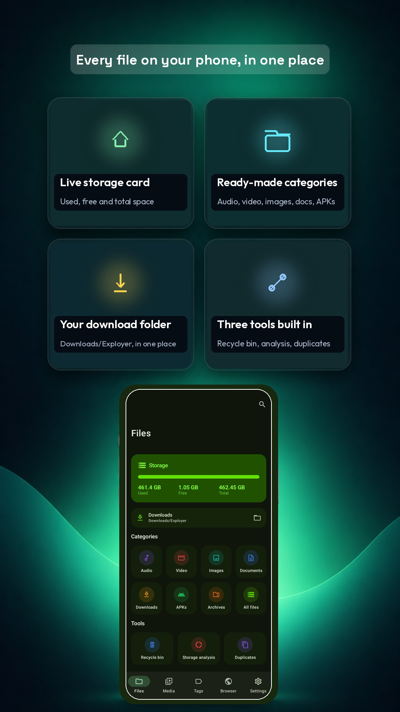
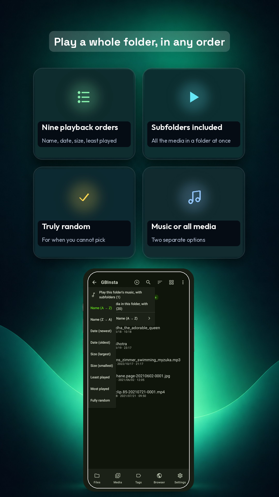
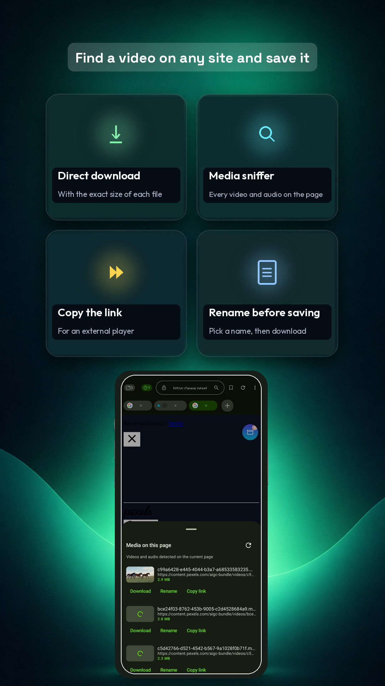
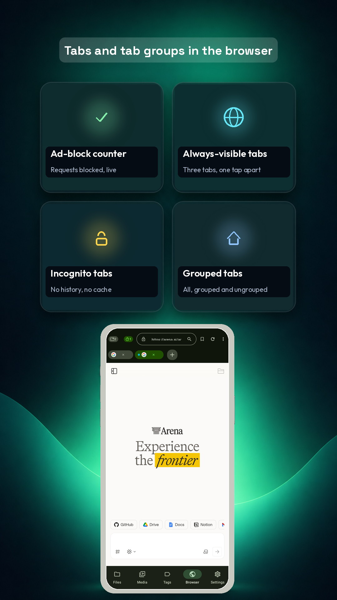
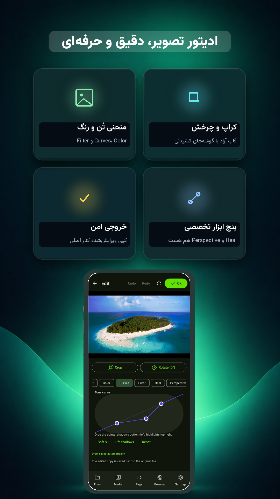
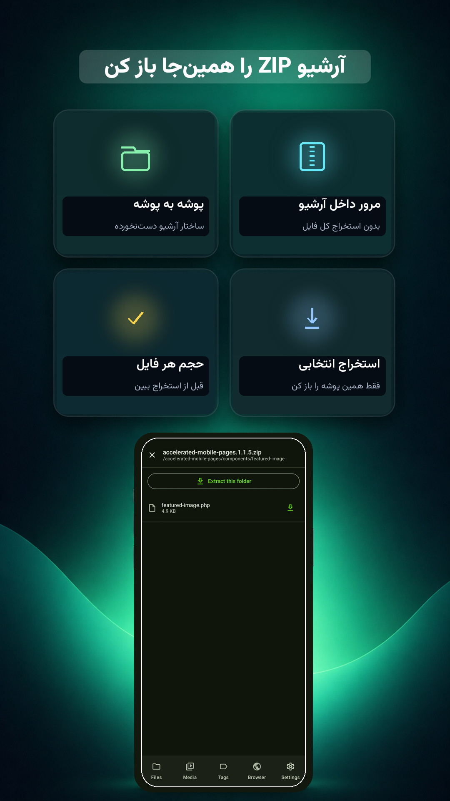

<p align="center">
  
</p>

<h1 align="center">Exployer — Android file manager, video downloader, browser &amp; photo editor</h1>

<p align="center">
  <b>One free APK instead of five apps.</b><br>
  File manager with a recycle bin and tags · music &amp; video player with smart folder play · browser with an
  ad blocker · HLS/DASH video downloader · photo and video editor · ZIP reader · AES-256 vault
</p>

<p align="center">
  <a href="https://github.com/balochscript/Exployer-App/releases/latest"></a>
  
  
  
</p>

<p align="center">
  <a href="https://github.com/balochscript/Exployer-App/releases/latest/download/exployer-0.9.103.apk"><b>⬇ Download the APK (9.1 MB)</b></a>
  ·
  <a href="docs/FEATURES.md">Every feature</a>
  ·
  <a href="CHANGELOG.md">Changelog</a>
  ·
  <a href="FAQ.md">FAQ</a>
  ·
  <a href="#verify">Verify the hash</a>
</p>

---

## Two builds, same features

| File | Size | When to use it |
|---|---|---|
| `exployer-0.9.103.apk` | **9.1 MB** | Normal choice. Shrunk and optimised by R8; identical features and behaviour. |
| `exployer-0.9.103-nor8.apk` | **18.0 MB** | Fallback only. Same code without R8 minification — use it if the small build ever misbehaves on an unusual device. |

Both files are signed with the same key and can update each other. Both are versionCode **113**.

---

## Screenshots

| Files | Play a whole folder | Downloader |
|---|---|---|
|  |  |  |
| **Browser with an ad blocker** | **Photo editor** | **ZIP reader** |
|  |  |  |

More screens: [download queue](docs/screenshots/05-downloads.jpg) · [global search](docs/screenshots/02-global-search.jpg) ·
[video player](docs/screenshots/04-video-player.jpg) · [browser home](docs/screenshots/08-browser-home.jpg) ·
[settings](docs/screenshots/10-settings.jpg) · [music library](docs/screenshots/12-music-library.jpg)

---

## What is Exployer?

Exployer is a single Android app that covers the everyday jobs people normally install five apps for.
It is built for phones with no Google Play account, no root and no sign-up: install the APK,
grant the "All files access" permission once, and everything runs on the device.

There is no cloud, no upload and no telemetry. Files, playback history, tags and the vault never
leave the phone.

## Features

The full catalogue, with the details behind every bullet, is in [docs/FEATURES.md](docs/FEATURES.md).
This is the short version.

### File manager
- Internal storage and SD card, list and grid views, a tappable breadcrumb to jump to any folder
- Sort by name, date, size or type, in both directions; global search across the whole storage
- Multi-select, range select ("first to last"), copy, move, delete, rename, share, properties
- Copy/move sheet with its own breadcrumb, new folder, hidden files
- Seven categories — audio, video, images, documents, downloads, APKs, archives — plus a live storage card
- Recent files (last five days) with its own type filter, open-containing-folder and properties
- Compress to ZIP, encrypt to `.enx`, decrypt, install an APK from the same list
- Built-in PDF and text viewer, so a document never has to leave the app
- Recycle bin: deleted files stay recoverable for up to 30 days
- Storage analysis: biggest folders, biggest files, split by kind (torrent files included); duplicate-file finder

### Tags
- Tag any file the moment you see it: from the file list, from Now Playing, or from the video/photo viewer
- Tag several files at once; a tag picker that shows "3 of 5" when only part of the selection already has it
- Ten colours, assigned automatically; rename, delete (files stay), search, five sort orders including
  "recently tagged"
- Play a whole tag: music only, or all its media, with the same nine orders and the same resume
- **MultiTagPlay**: long-press several tags and play them as one queue; a file that belongs to two
  selected tags is played once, not twice

### Music and video
- Library with silent refresh, queue, "add to queue", playback speed, sleep timer
- Equalizer with presets, bass boost and a virtualizer; always-visible mini player
- Background playback with notification controls; repeat off / all / one; shuffle
- Play a whole folder, subfolders included, in nine orders: name A→Z, name Z→A, date newest,
  date oldest, size largest, size smallest, least played, most played, fully random
- "Continue previous playback": the queue, the order and the kind filters are saved per folder,
  archive and tag, so the menu offers "continue at 7 of 42 · least played"
- A play is counted only after 10 seconds or 25 % progress, so "least played" and "most played" mean
  something real instead of counting every tap on Next
- Video player: horizontal drag to seek, vertical drag for volume and brightness, swipe-seek range
  0.5–20 %, touch lock, aspect ratio (fit / crop / stretch), hold for 2×, audio and subtitle track
  selection, fullscreen without system bars, manual rotation, picture-in-picture, one-tap screenshot,
  end-of-video behaviour, companion media
- Trim, crop, rotate and merge clips without a PC

### Browser and downloads
- Tabs, tab groups with eight colours (drag a card onto a group), incognito tabs, closed tabs restorable
  for 24 hours, session restore with the exact scroll position
- Tab bar in five positions (top, bottom, left, right, hidden), favicon-only tabs, bottom action bar
- Ad blocking from a list of common ad domains plus ad-slot hiding; data saver that holds back heavy
  images and video until you tap Load all, with a live counter of how many items it blocked
- Do Not Track and Sec-GPC headers, clear history/cache/cookies on exit
- Home page with editable shortcuts, custom search-engine pattern, find-in-page, per-site zoom,
  desktop mode, default text size, HTTPS/HTTP indicator
- Bookmarks, history, weekly visit and download stats, most visited sites
- Per-site camera, microphone and location permission (ask / allow / deny) with a management screen
- Media sniffer: a draggable floating bubble or an address-bar icon lists every video and audio stream on
  the current page with its exact size — the list is per page, so moving to the next page does not mix
  in the old streams. Rename before downloading, copy the direct link, rescan
- Download queue with percentage, speed, size and ETA; queue position; 1–15 files at once or unlimited
- Resumes from the exact byte, 3–30 automatic retries (or unlimited) with a custom delay between tries
- Scheduled downloads: date, time, retry count, delay, stop policy and a deadline; schedules survive
  reboots and app kills
- "Already downloaded" and "already in queue" warnings, real checksum verification of the finished file
- Clear error messages instead of silent failures: DRM, 403/404, an HTML page instead of a file, network,
  low storage, conversion failure, deadline reached
- HLS (M3U8) and DASH support, a capture fallback, and a custom download folder
- Pause or resume all downloads at once, clear the finished list, battery-optimisation shortcut

### Photos, archives and privacy
- Photo editor: free crop, rotate, exposure, contrast, highlights, shadows, saturation, vibrance,
  temperature, tint, tone curve with free control points, six filters, heal brush, perspective fix,
  undo/redo, automatic draft, save beside the original or to `Download/Exployer/Edit`
- Video editor: trim, crop, rotate, merge clips with dimension normalisation, background export with a
  progress notification — close the editor and the file is still built
- ZIP reader without extraction: browse an archive like a folder, extract the folder you are in or a
  single file, paste files into an archive, Zip-Slip protection, fast opening of very large archives,
  and play the media inside an archive with the same nine orders
- Encryption: chunked AES-256-GCM with PBKDF2 and the `.enx` extension, plus an encrypted folder
  container you can open and browse like a normal folder. Old `.enc` files still open — rename them
  to `.enx`
- Password vault with a master password, instant lock and master-password change

### Look and language
- System, light or dark theme, five accent palettes
- Eight languages: Persian, English, Spanish, Brazilian Portuguese, Indonesian, Hindi, Arabic, Urdu
  (plus "system language")
- Full right-to-left layout and Persian typography review

## Install

1. Download `exployer-0.9.103.apk` (9.1 MB) from the [Releases](https://github.com/balochscript/Exployer-App/releases/latest) panel.
2. Open it on the phone. If Android asks, allow installing from this source (your browser or file manager).
3. Launch Exployer and grant **All files access** — that permission is what a file manager needs.
4. Optional: allow "install unknown apps" only if you want to install APKs from inside the app.

Exployer 0.9.103 · versionCode 113 · package `com.balochscript.exployer` · Android 8.0 (API 26)+ ·
targetSdk 36 · 9.1 MB (R8 build) or 18.0 MB (no-R8 build)

## Verify

Compare the SHA-256 of the file you downloaded with the value below. Every release is signed with the
same key, so a mismatched file would also be rejected by Android on update.

```
SHA-256 (exployer-0.9.103.apk)       6bd897b87cb9cabc527c4fe6d5295fe086303bfd5d2d684d1d4e334f1779e7ca
SHA-256 (exployer-0.9.103-nor8.apk)  d53f6480bc5516123b94c595f80244a0eece17fb84816edc35c15e80ed38436d
```

```bash
# Windows
certutil -hashfile exployer-0.9.103.apk SHA256
# Linux / macOS
shasum -a 256 exployer-0.9.103.apk
# Android (Termux)
sha256sum exployer-0.9.103.apk
```

## What it does not do

Said plainly, so nobody downloads for the wrong reason:

- It cannot download DRM-protected streams, and it does not bypass logins or paywalls
- It cannot open password-protected ZIP archives
- It has no cloud sync, no account and no cross-device backup
- Ad blocking is a curated domain list, not a full uBlock-style subscription engine

## FAQ

Short answers here, the long ones in [FAQ.md](FAQ.md).

- **Is it really free?** Yes. No account, no subscription; the app is supported by ads, and rewarded
  videos turn them off — one video for 24 hours, five videos within those 24 hours for a full week.
- **Does it need root?** No. It uses the standard All-files-access permission.
- **Does it work offline?** The file manager, players, editor, ZIP reader and vault do. Only the browser
  and the downloader need a network.
- **Which Android versions?** 8.0 and newer, including Android 13–16 media permissions.
- **Why two APKs?** One is optimised with R8 (9.1 MB), the other is the same code unshrunk (18.0 MB).

## Privacy

No account, no analytics SDK, no upload. Camera, microphone and location are only exposed to a site
you opened, only after you approve it. Details in [PRIVACY.md](PRIVACY.md).

## Changelog

Every release and what changed, including the full 0.9.91 → 0.9.103 list: [CHANGELOG.md](CHANGELOG.md)

## Support

- Bugs and feature requests: [open an issue](https://github.com/balochscript/Exployer-App/issues)
- Email: balochscript@gmail.com
- Website: [balochscript.com](https://balochscript.com)

<sub>Exployer is made by Baloch Script. Android is a trademark of Google LLC. This project is not affiliated with Google.</sub>
