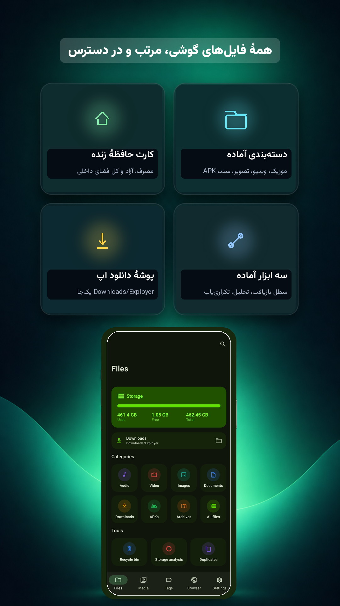
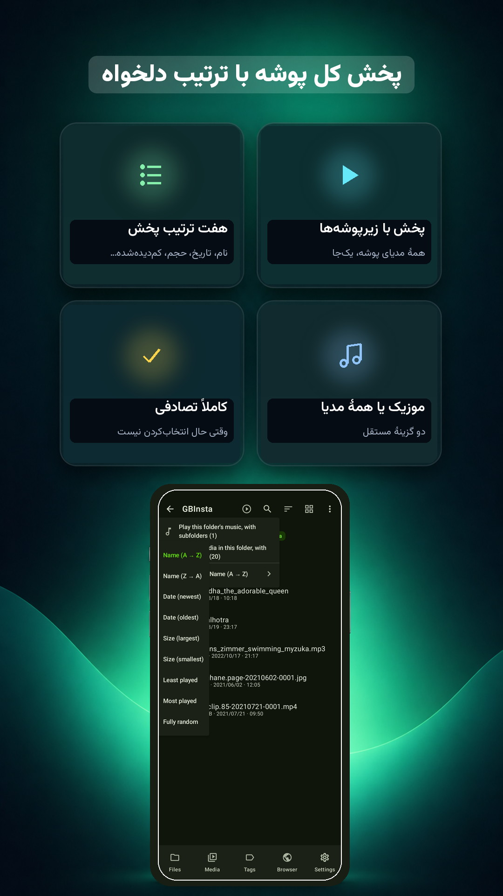
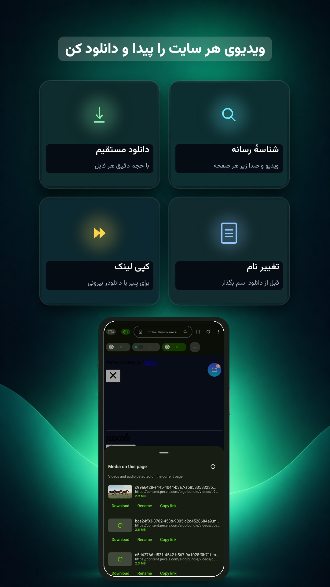
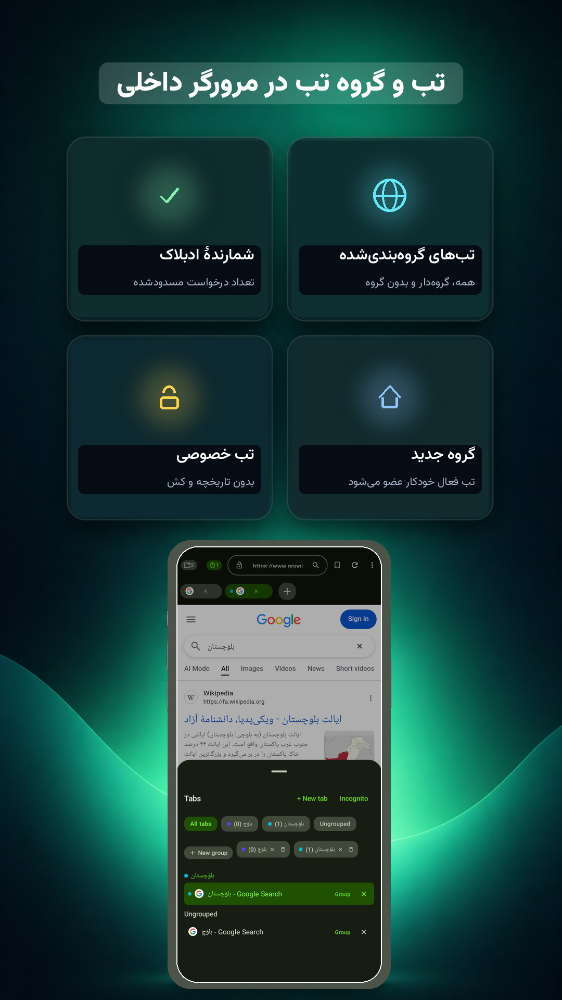
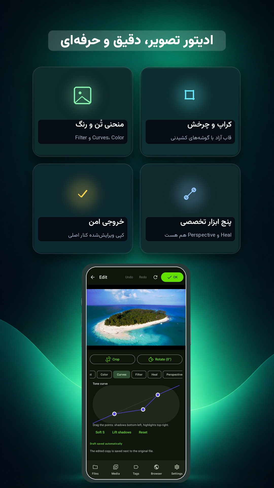
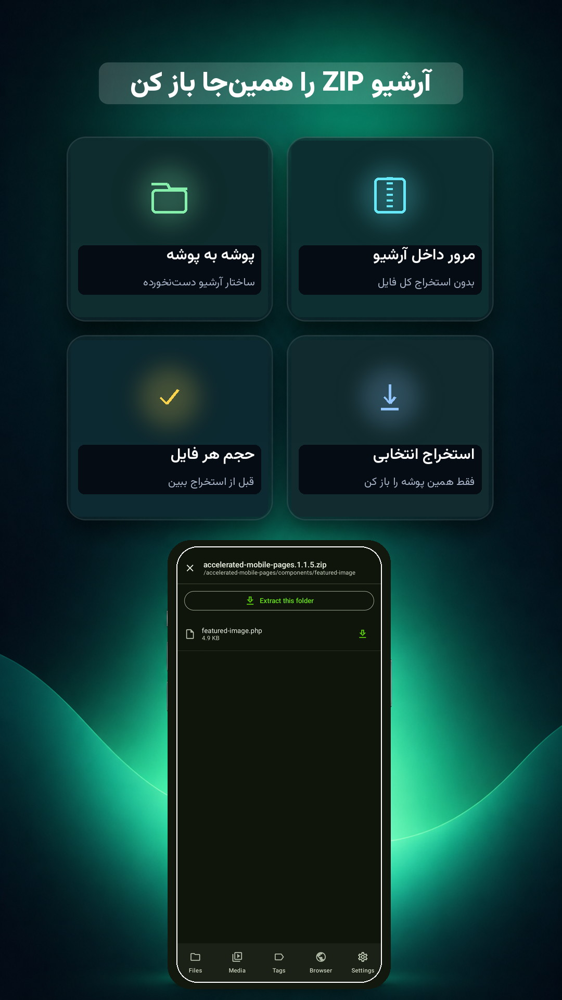

<p align="center">
  
</p>

<h1 align="center">Exployer — Android file manager, video downloader, browser &amp; photo editor</h1>

<p align="center">
  <b>One free APK instead of five apps.</b><br>
  File manager with a recycle bin · music &amp; video player · browser with an ad blocker ·
  HLS/DASH video downloader · photo and video editor · ZIP reader · AES-256 vault
</p>

<p align="center">
  <a href="https://github.com/balochscript/Exployer-App/releases/latest"></a>
  
  
  
</p>

<p align="center">
  <a href="https://github.com/balochscript/Exployer-App/releases/latest/download/exployer-0.9.37.apk"><b>⬇ Download the APK</b></a>
  ·
  <a href="https://balochscript.com/exployer-android-file-manager-video-downloader/">Feature guide</a>
  ·
  <a href="#install">Install</a>
  ·
  <a href="#verify">Verify the hash</a>
  ·
  <a href="FAQ.md">FAQ</a>
</p>

---

## Screenshots

| Files | Play a whole folder | Downloader |
|---|---|---|
|  |  |  |
| **Browser with an ad blocker** | **Photo editor** | **ZIP reader** |
|  |  |  |

More screens: [download queue](docs/screenshots/05-downloads.jpg) · [global search](docs/screenshots/02-global-search.jpg) ·
[video player](docs/screenshots/04-video-player.jpg) · [browser home](docs/screenshots/08-browser-home.jpg) ·
[settings](docs/screenshots/10-settings.jpg) · [music library](docs/screenshots/12-music-library.jpg)

---

## What is Exployer?

Exployer is a single Android app that covers the everyday jobs people normally install five apps for.
It is built for phones with no Google Play account, no root and no sign-up: install the APK,
grant the "All files access" permission once, and everything runs on the device.

There is no cloud, no upload and no telemetry. Files, playback history, tags and the vault never
leave the phone.

## Features

### File manager
- Internal storage and SD card, list and grid views, a tappable breadcrumb to jump to any folder
- Sort by name, date, size or type, in both directions; global search across the whole storage
- Multi-select, range select ("first to last"), copy, move, delete, rename, share, properties
- Copy/move sheet with its own breadcrumb, new folder, hidden files
- Seven categories — audio, video, images, documents, downloads, APKs, archives — plus a live storage card
- Compress to ZIP, encrypt to `.enc`, decrypt, install an APK from the same list
- Recycle bin: deleted files stay recoverable for up to 30 days
- Storage analysis: biggest folders, biggest files, split by kind; duplicate-file finder

### Music and video
- Library with silent refresh, queue, "add to queue", playback speed, sleep timer
- Equalizer with presets, bass boost and a virtualizer; always-visible mini player
- Background playback with notification controls
- Play a whole folder, subfolders included, in ten orders: name, date, size, least played, most played, random
- Video player: horizontal drag to seek, vertical drag for volume, swipe-seek range 0.5–20%,
  fullscreen without system bars, manual rotation, picture-in-picture, one-tap screenshot
- Trim, crop, rotate and merge clips without a PC

### Browser and downloads
- Tabs, tab groups, incognito tabs, closed tabs restorable for 24 hours, session restore
- Live ad-blocker counter, data saver, Do Not Track and Sec-GPC headers, clear-on-exit
- Home page with editable shortcuts, custom search-engine pattern, find-in-page, per-site zoom, desktop mode
- Media sniffer: an address-bar icon or draggable bubble lists every video and audio stream on a page with its exact size
- Download queue with percentage, speed and size; resumes from the exact byte; three automatic retries
- HLS (M3U8) and DASH support, a capture fallback, and a custom download folder
- Clear error messages instead of silent failures: DRM, 403/404, an HTML page instead of a file, network, low storage

### Photos, archives and privacy
- Photo editor: free crop, rotate, exposure, contrast, highlights, shadows, saturation, vibrance,
  temperature, tint, tone curve with free control points, six filters, heal brush, perspective fix,
  undo/redo with confirmation, automatic draft, save beside the original or to `Download/Exployer/Edit`
- ZIP reader without extraction, single-folder extraction, add files to an archive, Zip-Slip protection
- Password vault with AES-256-GCM and PBKDF2, instant lock, master-password change

## Install

1. Download `exployer-0.9.37.apk` from the [Releases](https://github.com/balochscript/Exployer-App/releases/latest) panel.
2. Open it on the phone. If Android asks, allow installing from this source (your browser or file manager).
3. Launch Exployer and grant **All files access** — that permission is what a file manager needs.
4. Optional: allow "install unknown apps" only if you want to install APKs from inside the app.

Exployer 0.9.37 · versionCode 47 · package `com.balochscript.exployer` · Android 8.0 (API 26)+ · 16.6 MB

## Verify

Compare the SHA-256 of the file you downloaded with the value below. Every release is signed with the
same key, so a mismatched file would also be rejected by Android on update.

```
SHA-256 (exployer-0.9.37.apk)
f49061dca1bd4962b711a3a6ed2da641c8a98d0bca72f420a8a11ad7f9eb31bc
```

```bash
# Windows
certutil -hashfile exployer-0.9.37.apk SHA256
# Linux / macOS
shasum -a 256 exployer-0.9.37.apk
# Android (Termux)
sha256sum exployer-0.9.37.apk
```

## FAQ

Short answers here, the long ones in [FAQ.md](FAQ.md).

- **Is it really free?** Yes. No account, no subscription; the app is supported by ads and five rewarded videos remove them for a week.
- **Does it need root?** No. It uses the standard All-files-access permission.
- **Does it work offline?** The file manager, players, editor, ZIP reader and vault do. Only the browser and the downloader need a network.
- **Can it save Instagram, YouTube or TikTok videos?** It saves streams a page loads as plain media (MP4, HLS, DASH). It cannot save DRM-protected streams and does not bypass logins or paywalls.
- **Are my files uploaded anywhere?** No.
- **Which Android versions?** 8.0 and newer, including Android 13–16 media permissions.

## Privacy

No account, no analytics SDK, no upload. Camera, microphone and location are only exposed to a site
you opened, only after you approve it. Details in [PRIVACY.md](PRIVACY.md).

## Changelog

Every release and what changed: [CHANGELOG.md](CHANGELOG.md).

## Support

- Bugs and feature requests: [open an issue](https://github.com/balochscript/Exployer-App/issues)
- Email: balochscript@gmail.com
- Website: [balochscript.com](https://balochscript.com)

<sub>Exployer is made by Baloch Script. Android is a trademark of Google LLC. This project is not affiliated with Google.</sub>
