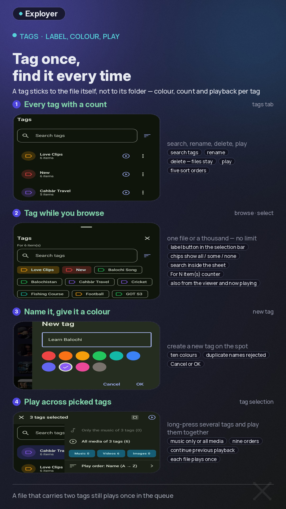

<p align="center">
  
</p>

<h1 align="center">Exployer — gerenciador de arquivos, downloader de vídeos, navegador e editor de fotos para Android</h1>

<p align="center">
  <b>Um APK gratuito em vez de cinco aplicativos.</b><br>
  Gerenciador de arquivos com lixeira e tags · player de música e vídeo com reprodução inteligente de pasta ·
  navegador com bloqueador de anúncios · downloader de vídeos HLS/DASH · editor de fotos e vídeos · leitor de
  ZIP · cofre AES-256
</p>

<p align="center">
  <a href="https://github.com/balochscript/Exployer-App/releases/latest"></a>
  
  
  
</p>

<p align="center">
  <a href="https://github.com/balochscript/Exployer-App/releases/latest/download/exployer-0.9.103.apk"><b>⬇ Baixar o APK (9,1 MB)</b></a>
  ·
  <a href="docs/FEATURES.md">Todos os recursos</a>
  ·
  <a href="CHANGELOG.md">Changelog</a>
  ·
  <a href="FAQ.md">Perguntas frequentes</a>
  ·
  <a href="#verificar">Verificar o hash</a>
</p>

<p align="center">
  <b>Leia em:</b>
  <a href="README.md">English</a> ·
  <a href="README.fa.md">فارسی</a> ·
  <a href="README.es.md">Español</a> ·
  <a href="README.pt-BR.md">Português (BR)</a> ·
  <a href="README.id.md">Bahasa Indonesia</a> ·
  <a href="README.hi.md">हिन्दी</a> ·
  <a href="README.ar.md">العربية</a> ·
  <a href="README.ur.md">اردو</a>
</p>

---

## Duas compilações, os mesmos recursos

| Arquivo | Tamanho | Quando usar |
|---|---|---|
| `exployer-0.9.103.apk` | **9,1 MB** | Escolha normal. Reduzido e otimizado com R8; recursos e comportamento idênticos. |
| `exployer-0.9.103-nor8.apk` | **18,0 MB** | Só como reserva. O mesmo código sem minificação R8 — use se a compilação pequena falhar num dispositivo incomum. |

Ambos os arquivos são assinados com a mesma chave e podem se atualizar entre si. Ambos são versionCode **113**.

---

## Capturas de tela

| | | | |
|---|---|---|---|
|  |  |  |  |
| **Gerenciador de arquivos** | **Reproduzir uma pasta** | **Player de vídeo** | **Player de música** |
|  |  |  | |
| **Tags** | **Navegador** | **Downloads** | |

Todas têm 1080 × 1920 e também existem em persa — o conjunto em persa é o que aparece na listagem do Cafe
Bazaar do app. Como os conjuntos são construídos e o que os textos afirmam está descrito em
[docs/screenshots/README.md](docs/screenshots/README.md).

---

## O que é o Exployer?

O Exployer é um único aplicativo Android que cobre as tarefas do dia a dia para as quais as pessoas
normalmente instalam cinco aplicativos. É feito para telefones sem conta do Google Play, sem root e sem
cadastro: instale o APK, conceda uma vez a permissão "Acesso a todos os arquivos" e tudo roda no aparelho.

Não há nuvem, upload nem telemetria. Arquivos, histórico de reprodução, tags e o cofre nunca saem do
telefone.

## Recursos

O catálogo completo, com os detalhes de cada item, está em [docs/FEATURES.md](docs/FEATURES.md).
Esta é a lista completa — os recursos grandes e os pequenos.

### Gerenciador de arquivos
- Armazenamento interno e cartão SD, visualização em lista e grade, breadcrumb tocável para pular para
  qualquer pasta
- Ordenar por nome, data, tamanho ou tipo, em ambas as direções; busca global em todo o armazenamento
- Seleção única, múltipla e por intervalo ("do primeiro ao último"); copiar, mover, excluir, renomear,
  compartilhar, propriedades
- Painel de copiar/mover com seu próprio breadcrumb, nova pasta, arquivos ocultos
- Oito categorias — áudio, vídeo, imagens, documentos, downloads, APKs, arquivos, todos os arquivos — mais um cartão de
  armazenamento ao vivo (usado / livre / total) na tela inicial
- Arquivos recentes (últimos cinco dias) com filtro de tipo, abrir-pasta-mãe e propriedades; avisa
  honestamente quando o armazenamento era grande demais para escanear por completo
- Compactar para ZIP, criptografar para `.enx`, descriptografar e instalar um APK pela mesma lista
- Visualizador de PDF e de texto embutido, para que um documento nunca precise sair do app
- Lixeira: arquivos excluídos ficam recuperáveis por até 30 dias, com contagem regressiva
- Análise de armazenamento: maiores pastas e arquivos, divididos por tipo (inclui torrents); localizador
  de duplicados que move as cópias extras para a lixeira

### Tags
- Marque qualquer arquivo no momento em que o vê — pela lista de arquivos (toque longo → selecionar →
  botão de tag na barra de seleção), pelo Now Playing ou pelo visualizador de fotos/vídeos. Não há limite
  de tags por arquivo
- Marcação em lote: selecione vários arquivos e aplique uma tag numa única ação; o seletor mostra "3 de 5"
  quando só parte da seleção já a tem, e os chips mostram tudo / parte / nada
- Dez cores, atribuídas automaticamente; criar (também dentro do seletor), renomear, excluir — excluir uma
  tag nunca apaga arquivos, o diálogo diz isso
- Nomes de tag duplicados são rejeitados (caracteres árabe/persa parecidos são normalizados antes)
- Busca dentro da lista de tags; cinco ordenações: mais itens, menos itens, mais recente, mais antiga,
  marcadas recentemente
- Reproduzir uma tag inteira: só a música dela, ou toda a mídia dela, com as mesmas nove ordens e a mesma
  retomada
- **MultiTagPlay**: toque longo em várias tags e reproduza tudo como uma única fila; um arquivo que
  pertence a duas tags selecionadas é reproduzido uma vez, não duas; "continuar a reprodução anterior" e
  "selecionar tudo" respeitam a busca atual de tags

### Música e vídeo
- Biblioteca com atualização silenciosa, fila, "adicionar à fila", velocidade de reprodução (0,25×–3,0×),
  temporizador de sono com tempo restante, repetir desligado / tudo / uma, aleatório
- Equalizador com predefinições, reforço de graves e virtualizador, mais um reset; miniplayer sempre visível
- Reprodução em segundo plano com controles de notificação; as notificações seguem o idioma do app
- Reproduzir uma pasta inteira (subpastas incluídas, até 24 níveis e 20.000 arquivos — e diz quando um
  limite é realmente atingido) em nove ordens: nome A→Z, nome Z→A, data mais nova, data mais antiga, maior
  tamanho, menor tamanho, menos reproduzidas, mais reproduzidas, totalmente aleatório
- Chips de filtro por tipo (música / vídeo / imagens) com contagens, alternáveis antes de reproduzir
- "Continuar a reprodução anterior": a fila, a ordem, o filtro de tipo e o item atual são salvos por pasta,
  arquivo, tag e conjunto multi-tag — o menu oferece "continuar em 7 de 42 · menos reproduzidas"
- Uma reprodução só é contada após 10 segundos ou 25 % de progresso, então "menos reproduzidas" significa
  algo real
- Player de vídeo: arraste horizontal para buscar, vertical para volume e brilho, faixa de busca por
  deslize 0,5–20 %, toque duplo para pausar/reproduzir, segurar para 2×, bloqueio de toque, proporção
  (ajustar / preencher / esticar), seleção de faixa de áudio e legenda, tela cheia sem barras do sistema,
  rotação manual, picture-in-picture, captura de tela com um toque, comportamento no fim do vídeo
  (repetir / parar / próximo), mídia acompanhante, recortar e aparar direto do player

### Navegador (Baloch Core)
- A renderização é feita pelo WebView Chromium do sistema; abas, bloqueio, privacidade e estatísticas são
  código próprio do Exployer
- Abas, pré-visualizações de abas, grupos de abas com oito cores — arraste o cartão de uma aba para o chip
  do grupo, com desfazer; fechar um grupo mantém as abas abertas e recuperáveis por 24 horas
- Abas de incógnito (nada é guardado), abas fechadas recuperáveis por 24 horas, restauração de sessão com
  a posição exata do scroll
- Barra de abas em cinco posições (topo, base, esquerda, direita, oculta); abas só com favicon; barra
  inferior opcional
- Bloqueio de anúncios com uma lista curada de domínios mais ocultação de espaços publicitários; o economia
  de dados retém imagens e vídeos pesados até você tocar "Carregar tudo" (desligado por padrão)
- Interruptor opcional Do Not Track / Sec-GPC (desligado por padrão); limpar histórico, cache e cookies ao sair
- Página inicial com atalhos editáveis, padrão de mecanismo de busca personalizado, localizar na página,
  zoom por site memorizável, modo desktop, tamanho de texto padrão, indicador HTTPS/HTTP
- Favoritos, histórico, estatísticas do navegador (visitas e downloads totais e semanais, sites mais visitados)
- Permissão de câmera, microfone e localização por site (perguntar / permitir / negar) com tela de gerenciamento
- Sniffer de mídia: uma bolha flutuante arrastável ou um ícone na barra de endereço lista todos os vídeos e
  áudios da página atual com o tamanho exato — por página, então a próxima página nunca mistura streams
  antigos; renomeie antes de baixar, copie o link direto, reescaneie

### Downloads
- Fila com porcentagem, velocidade, tamanho, tempo restante e posição na fila; de 1 a 15 arquivos de uma vez,
  ou ilimitados
- Retoma do byte exato (requisição Range, não um reinício)
- De 3 a 30 tentativas automáticas (ou ilimitadas) com um atraso personalizado opcional; uma política de
  parada decide se o motor continua tentando, para no primeiro erro ou para num prazo
- Downloads agendados: data, hora, número de tentativas, atraso, política de parada e prazo; os agendamentos
  sobrevivem ao fechamento forçado do app e a reinicializações
- Detecção de "já baixado" e "já está na fila"; verificação real de checksum do arquivo concluído
- Mensagens de erro honestas: protegido por DRM, 403/404, uma página HTML em vez de um arquivo (anti-leech),
  rede, armazenamento cheio, falha de conversão, prazo atingido — cada uma com o próximo passo
- Suporte a HLS (M3U8) e DASH, um fallback de captura, pasta de download personalizada
  (padrão `Downloads/Exployer`)
- Pausar ou retomar tudo de uma vez, pausar/iniciar/repetir/abrir/compartilhar/excluir por item, seleção em
  lote, limpar a lista de concluídos, abas Tudo / Ativos / Agendados, ordenar por progresso, velocidade ou status
- Notificações de download com progresso e controles enquanto o app está fechado

### Editor de fotos e vídeos
- Recorte livre com o tamanho de pixel de saída exibido, girar
- Oito controles deslizantes de luz e cor: exposição, contraste, realces, sombras, saturação, vivacidade,
  temperatura, matiz
- Curva tonal com pontos livres, mais curvas prontas; seis filtros
- Pincel de correção com tamanho ajustável e desfazer do último traço; correção de perspectiva arrastando
  quatro cantos
- Desfazer e refazer; rascunho automático para que sair do editor não perca o trabalho
- Três destinos de salvamento: junto ao original, `Download/Exployer/Edit`, ou substituir o original (a cópia
  anterior vai para a lixeira)
- Editor de vídeo: aparar, recortar, girar, mesclar clipes com normalização de dimensões, exportação em
  segundo plano com notificação de progresso — feche o editor e o arquivo continua sendo criado

### ZIP, criptografia, privacidade
- Navegar num arquivo ZIP como uma pasta sem extrair; extrair a pasta atual ou um único arquivo com progresso
  por bytes; colar arquivos dentro do ZIP; proteção Zip-Slip; abertura rápida de ZIPs muito grandes; reproduzir
  a mídia dentro do ZIP com as mesmas nove ordens (pede antes de extrair)
- Criptografia `.enx`: AES-256-GCM em blocos com chave derivada por PBKDF2, mais um contêiner de pasta
  criptografada que abre e navega como uma pasta normal após uma senha; arquivos antigos `.enc` ainda abrem
- Cofre de senhas: uma senha mestra definida uma vez, entradas com site / usuário / senha / nota, bloqueio
  instantâneo, troca da senha mestra; a senha mestra nunca é armazenada

### Aparência, idioma e anúncios
- Tema do sistema / claro / escuro, cinco paletas de cor de destaque
- Oito idiomas: persa, inglês, espanhol, português do Brasil, indonésio, hindi, árabe, urdu — independentes
  do idioma do telefone, aplicados também às notificações; leiaute completo da direita à esquerda
- Grátis e sustentado por anúncios (Tapsell): um vídeo recompensado completo desliga os anúncios por 24 horas,
  cinco vídeos dentro dessas 24 horas desligam por uma semana; o contador avisa antes de reiniciar

## Instalação

1. Baixe `exployer-0.9.103.apk` (9,1 MB) no painel de [Releases](https://github.com/balochscript/Exployer-App/releases/latest).
2. Abra no telefone. Se o Android pedir, permita instalar desta fonte (seu navegador ou gerenciador de arquivos).
3. Abra o Exployer e conceda **Acesso a todos os arquivos** — é a permissão que um gerenciador de arquivos precisa.
4. Opcional: permita "instalar apps desconhecidos" só se quiser instalar APKs de dentro do app.

Exployer 0.9.103 · versionCode 113 · pacote `com.balochscript.exployer` · Android 8.0 (API 26)+ ·
targetSdk 36 · 9,1 MB (build R8) ou 18,0 MB (sem R8)

## Verificar

Compare o SHA-256 do arquivo baixado com o valor abaixo. Cada versão é assinada com a mesma chave, então um
arquivo adulterado também seria rejeitado pelo Android na atualização.

```
SHA-256 (exployer-0.9.103.apk)       6bd897b87cb9cabc527c4fe6d5295fe086303bfd5d2d684d1d4e334f1779e7ca
SHA-256 (exployer-0.9.103-nor8.apk)  d53f6480bc5516123b94c595f80244a0eece17fb84816edc35c15e80ed38436d
```

```bash
# Windows
certutil -hashfile exployer-0.9.103.apk SHA256
# Linux / macOS
shasum -a 256 exployer-0.9.103.apk
# Android (Termux)
sha256sum exployer-0.9.103.apk
```

## O que ele não faz

Dito com clareza, para que ninguém baixe pelo motivo errado:

- Não pode baixar streams protegidos por DRM, nem contorna logins ou paywalls
- Não abre arquivos ZIP protegidos por senha
- Não tem sincronização na nuvem, conta nem backup entre dispositivos
- O bloqueio de anúncios é uma lista curada de domínios, não um motor de assinaturas estilo uBlock

## Perguntas frequentes

Respostas curtas aqui, as longas em [FAQ.md](FAQ.md).

- **É grátis mesmo?** Sim. Sem conta, sem assinatura; o app é sustentado por anúncios, e vídeos recompensados
  os desligam — um por 24 horas, cinco dentro dessas 24 horas por uma semana.
- **Precisa de root?** Não. Usa a permissão padrão de acesso a todos os arquivos.
- **Funciona offline?** O gerenciador de arquivos, os players, o editor, o ZIP e o cofre sim. Só o navegador e
  o downloader precisam de rede.
- **Quais versões do Android?** 8.0 e mais novas, incluindo as permissões de mídia do Android 13–16.
- **Por que dois APKs?** Um é otimizado com R8 (9,1 MB), o outro é o mesmo código sem redução (18,0 MB).

## Privacidade

Sem conta, sem SDK de análise, sem upload. Câmera, microfone e localização só são expostos a um site que você
abriu e só após sua aprovação. Detalhes em [PRIVACY.md](PRIVACY.md).

## Changelog

Cada versão e o que mudou, incluindo a lista completa 0.9.91 → 0.9.103: [CHANGELOG.md](CHANGELOG.md)

## Suporte

- Bugs e sugestões: [abra uma issue](https://github.com/balochscript/Exployer-App/issues)
- Email: balochscriptcom@gmail.com
- Site: [balochscript.com](https://balochscript.com)

<sub>O Exployer é feito pela Baloch Script. Android é uma marca comercial da Google LLC. Este projeto não é afiliado à Google.</sub>
