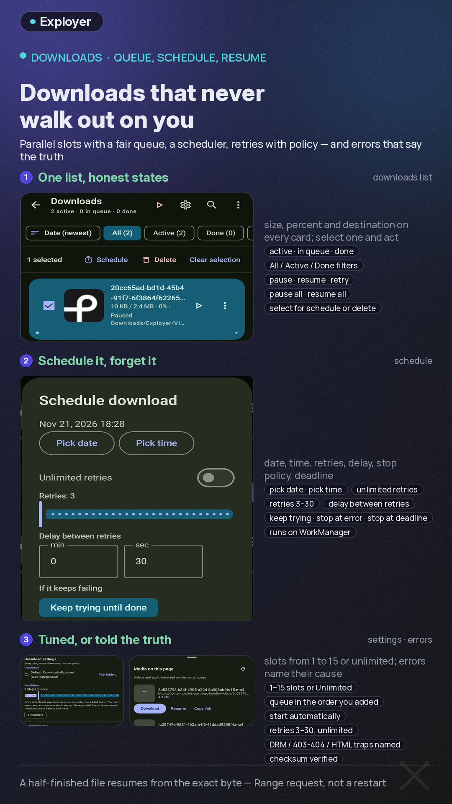

<div dir="rtl">

<p align="center">
  
</p>

<h1 align="center">Exployer — Android فائل مینیجر، ویڈیو ڈاؤن لوڈر، براؤزر اور فوٹو ایڈیٹر</h1>

<p align="center">
  <b>پانچ ایپس کی جگہ ایک مفت APK۔</b><br>
  ریسائیکل بن اور ٹیگس والا فائل مینیجر · سمارٹ فولڈر پلے والا میوزک اور ویڈیو پلیئر · ایڈ بلاکر والا
  براؤزر · HLS/DASH ویڈیو ڈاؤن لوڈر · فوٹو اور ویڈیو ایڈیٹر · ZIP ریڈر · AES-256 والٹ
</p>

<p align="center">
  <a href="https://github.com/balochscript/Exployer-App/releases/latest"></a>
  
  
  
</p>

<p align="center">
  <a href="https://github.com/balochscript/Exployer-App/releases/latest/download/exployer-0.9.103.apk"><b>⬇ APK ڈاؤن لوڈ کریں (9.1 MB)</b></a>
  ·
  <a href="docs/FEATURES.md">تمام فیچرز</a>
  ·
  <a href="CHANGELOG.md">تبدیلیوں کا ریکارڈ</a>
  ·
  <a href="FAQ.md">عام سوالات</a>
  ·
  <a href="#تصدیق">ہیش تصدیق</a>
</p>

<p align="center">
  <b>دوسری زبانوں میں پڑھیں:</b>
  <a href="README.md">English</a> ·
  <a href="README.fa.md">فارسی</a> ·
  <a href="README.es.md">Español</a> ·
  <a href="README.pt-BR.md">Português (BR)</a> ·
  <a href="README.id.md">Bahasa Indonesia</a> ·
  <a href="README.hi.md">हिन्दी</a> ·
  <a href="README.ar.md">العربية</a> ·
  <a href="README.ur.md">اردو</a>
</p>

---

## دو بلڈز، وہی فیچرز

| فائل | سائز | کب استعمال کریں |
|---|---|---|
| `exployer-0.9.103.apk` | **9.1 MB** | عام انتخاب۔ R8 سے چھوٹا اور بہتر بنایا گیا؛ وہی فیچرز، وہی رویہ۔ |
| `exployer-0.9.103-nor8.apk` | **18.0 MB** | صرف بیک اپ۔ R8 مینیفیکیشن کے بغیر وہی کوڈ — اگر چھوٹا بلڈ کسی غیر عام ڈیوائس پر خرابی کرے۔ |

دونوں فائلیں ایسی ہی کی سے سائن ہیں اور ایک دوسرے پر اپڈیٹ ہو سکتی ہیں۔ دونوں versionCode **113** ہیں۔

---

## اسکرین شاٹس

| | | | |
|---|---|---|---|
|  |  |  |  |
| **فائل مینیجر** | **پورا فولڈر چلائیں** | **ویڈیو پلیئر** | **میوزک پلیئر** |
|  |  |  | |
| **ٹیگس** | **براؤزر** | **ڈاؤن لوڈز** | |

ساتوں تصاویر 1080 × 1920 کی ہیں اور فارسی میں بھی موجود ہیں — فارسی سیٹ وہی ہے جو ایپ کی Cafe Bazaar
لسٹنگ پر نظر آتی ہے۔ یہ کیسے بنتی ہیں اور کیپشنز کیا دعویٰ کرتے ہیں، یہ [docs/screenshots/README.md](docs/screenshots/README.md) میں ہے۔

---

## Exployer کیا ہے؟

Exployer ایک ہی Android ایپ ہے جو روزمرہ کے وہ کام کرتی ہے جن کے لیے لوگ عام طور پر پانچ ایپس انسٹال
کرتے ہیں۔ یہ ان فونز کے لیے بنائی گئی ہے جن میں Google Play اکاؤنٹ نہیں، روٹ نہیں اور سائن اپ نہیں:
APK انسٹال کریں، ایک بار "All files access" کی اجازت دیں، اور سب کچھ ڈیوائس پر ہی چلتا ہے۔

کوئی کلاؤڈ نہیں، کوئی اپلوڈ نہیں، کوئی ٹیلی میٹری نہیں۔ فائلیں، پلے بیک ہسٹری، ٹیگس اور والٹ کبھی فون
نہیں چھوڑتے۔

## فیچرز

مکمل کیٹلاگ، ہیر نکتے کی تفصیل کے ساتھ، [docs/FEATURES.md](docs/FEATURES.md) میں ہے۔
یہ مکمل فہرست ہے — بڑے اور چھوٹے فیچرز۔

### فائل مینیجر
- انٹرنل اسٹوریج اور SD کارڈ، لسٹ اور گرڈ ویو، کسی بھی فولڈر پر چھلانگ کے لیے ٹیپ کرنے کے قابل بریڈکرمب
- نام، تاریخ، سائز یا قسم سے دونوں سمتوں میں ترتیب؛ پورے اسٹوریج میں گلوبل تلاش
- واحد، متعدد اور رینج سلیکشن ("پہلے سے آخری تک")؛ کاپی، منتقلی، حذف، نام تبدیل، شیئر، پراپرٹیز
- کاپی/منتقلی شیٹ کا اپنا بریڈکرمب، نیا فولڈر، چھپی ہوئی فائلیں
- آٹھ کیٹگریز — آڈیو، ویڈیو، تصاویر، دستاویزات، ڈاؤن لوڈز، APKs، آرکائیوز، تمام فائلیں — اور ہوم اسکرین پر لائیو
  اسٹوریج کارڈ (استعمال شدہ / خالی / کل)
- حالیہ فائلیں (پچھلے پانچ دن) اپنے ٹائپ فلٹر، اپن فولڈر اور پراپرٹیز کے ساتھ؛ اسٹوریج بہت بڑا ہو تو مکمل
  سکین نہ ہونے کی ایماندارانہ اطلاع
- ZIP بنائیں، `.enx` میں انکرپٹ، ڈیکرپٹ، اسی لسٹ سے APK انسٹال
- بلٹ اِن PDF اور ٹیکسٹ ویوئر، تاکہ دستاویز کو ایپ چھوڑنا نہ پڑے
- ریسائیکل بن: حذف شدہ فائلیں 30 دن تک بحال ہو سکتی ہیں، کاؤنٹ ڈاؤن کے ساتھ
- اسٹوریج تجزیہ: سب سے بڑے فولڈرز اور فائلیں، قسم کے حساب سے (ٹورنٹ فائلیں بھی)؛ ڈپلیکیٹ فائل تلاش کار
  جو اضافی کاپیوں کو ریسائیکل بن بھیجتا ہے

### ٹیگس
- کسی فائل کو دیکھتے ہی ٹیگ کریں — فائل لسٹ سے (لمبا دبانہ → سلیکٹ → سلیکشن بار کا ٹیگ بٹن)، Now
  Playing سے، یا فوٹو/ویڈیو ویوئر سے۔ ایک فائل پر کتنی بھی ٹیگس ہو سکتی ہیں، کوئی حد نہیں
- بلک ٹیگنگ: کئی فائلیں منتخب کریں اور ایک عمل میں ٹیگ لگائیں؛ جب سلیکشن کا کچھ حصہ ہی ٹیگ رکھتا ہو
  تو پکر "3 of 5" دکھاتا ہے، اور چپس all / some / none دکھاتے ہیں
- دس رنگ، نئے ٹیگس پر خودکار؛ بنائیں (پکر کے اندر سے بھی)، نام بدلیں، حذف کریں — ٹیگ حذف کرنا فائلیں
  کبھی نہیں مٹاتا، ڈائیلاگ یہی کہتا ہے
- ہم نام ٹیگ مسترد ہوتے ہیں (ملتے جلتے عربی/فارسی حروف پہلے نارمل کیے جاتے ہیں)
- ٹیگ لسٹ میں تلاش؛ پانچ ترتیبیں: سب سے زیادہ آئٹمز، سب سے کم آئٹمز، نئی ترین، پرانی ترین، حال ہی میں
  ٹیگ کی گئیں
- پورا ٹیگ چلائیں: صرف اس کا میوزک یا اس کا سارا میڈیا، وہی نوں ترتیبیں اور وہی دوبارہ آغاز
- **MultiTagPlay**: کئی ٹیگس پر لمبا دبانہ لگائیں اور ان کا سارا مواد ایک کیو کے طور پر چلائیں؛ دو منتخب
  ٹیگس میں شامل کوئی فائل ایک بار چلتی ہے، دو بار نہیں؛ "پچھلا پلے بیک جاری رکھیں" اور "سب منتخب کریں"
  موجودہ ٹیگ تلاش کا احترام کرتے ہیں

### میوزک اور ویڈیو
- خاموش ریفریش والی لائبریری، کیو، "کیو میں شامل کریں"، پلے بیک اسپیڈ (0.25×–3.0×)، باقی وقت کے ساتھ
  سلپ ٹائمر، دہرانا بند / سب / ایک، شفل
- پری سیٹس، بیس بوسٹ اور ورچوئلائزر والا اکولائزر، ریسیٹ بھی؛ ہمیشہ نظر آنے والا منی پلیئر
- نوٹیفیکیشن کنٹرولز کے ساتھ بیک گراؤنڈ پلے بیک؛ نوٹیفیکیشنز ایپ کی زبان اپناتے ہیں
- پورا فولڈر چلائیں (سب فولڈرز شامل، 24 سطحیں اور 20,000 فائلوں تک — اور حد واقعی چھوہے تو بتاتا ہے)
  نوں ترتیبوں میں: نام A→Z، نام Z→A، نئی تاریخ، پرانی تاریخ، بڑا سائز، چھوٹا سائز، کم چلی، زیادہ چلی، پورا رینڈم
- کنڈ فلٹر چپس (میوزک / ویڈیو / تصاویر) شمار کے ساتھ، پلے دبانے سے پہلے بدلے جا سکتے ہیں
- "پچھلا پلے بیک جاری رکھیں": کیو، ترتیب، کنڈ فلٹر اور موجودہ آئٹم ہر فولڈر، آرکائیو، ٹیگ اور ملٹی ٹیگ سیٹ
  کے لیے محفوظ ہوتے ہیں — مینو "7 of 42 · least played پر جاری رکھیں" دیتا ہے
- کوئی پلے صرف 10 سیکنڈ یا 25 % پیش رفت کے بعد گنا جاتا ہے، تاکہ "least played" کا اصل مطلب ہو
- ویڈیو پلیئر: سیک کے لیے افقی کھینچنا، والیوم اور برائٹنس کے لیے عمودی کھینچنا، 0.5–20 % سوائپ سیک رینج،
  ڈبل ٹیپ پاز/پلے، 2× کے لیے دبائے رکھیں، ٹچ لاک، اسپیکٹ ریشیو (فٹ / کراپ / اسٹریچ)، آڈیو اور سب ٹائٹل ٹریک
  انتخاب، سسٹم بارز کے بغیر فل اسکرین، دستی روٹیشن، پکچر اِن پکچر، ایک ٹیپ اسکرین شاٹ، ویڈیو کے اختتام کا
  رویہ (دوبارہ / رک جاؤ / اگلا)، ہم نشین میڈیا، پلیئر سے ہی کراپ اور ٹرم

### براؤزر (Baloch Core)
- رینڈرنگ سسٹم Chromium WebView سے؛ ٹیبس، بلاکنگ، پرائیویسی اور اعداد و شمار Exployer کا اپنا کوڈ ہیں
- ٹیبس، ٹیب پری ویوز، آٹھ رنگوں کے ٹیب گروپس — ٹیب کارڈ کو گروپ چپ پر کھینچیں، اَنڈو کے ساتھ؛ گروپ بند
  کرنے سے اس کے ٹیبس کھلے رہتے ہیں اور 24 گھنٹے قابل بحال رہتے ہیں
- نجی (اِنکاگنیٹو) ٹیبس (کچھ نہیں رکھا جاتا)، بند ٹیبس 24 گھنٹے قابل بحال، درست اسکرول پوزیشن کے ساتھ
  سیشن بحالی
- پانچ مقامات پر ٹیب بار (اوپر، نیچے، بائیں، دائیں، چھپا)؛ صرف فیویکون والے ٹیبس؛ اختیاری نیچے والا بار
- منتخب شدہ ڈومینز کی فہرست سے ایڈ بلاکنگ اور ایڈ سلاٹ چھپانا؛ ڈیٹا سیور بھاری تصاویر اور ویڈیو کو "Load
  all" دبانے تک روکے رکھتا ہے (بذاتِ خود بند ہوتا ہے)
- اختیاری Do Not Track / Sec-GPC سوئچ (بذاتِ خود بند)؛ باہر جاتے وقت ہسٹری، کیش اور کوکیز صاف کریں
- قابلِ ترمیم شارٹ کٹس والا ہوم پیج، اپنا سرچ انجن پیٹرن، Find in page، یاد رہنے والا فی سائٹ زوم، ڈیسک ٹاپ
  موڈ، ڈیفالٹ ٹیکسٹ سائز، HTTPS/HTTP اشارہ
- بک مارکس، ہسٹری، براؤزر کے اعداد و شمار (کل اور ہفتہ وار وزٹس اور ڈاؤن لوڈز، سب سے زیادہ دیکھی گئی سائٹس)
- فی سائٹ کیمرہ، مائیکروفون اور لوکیشن اجازت (پوچھیں / اجازت / انکار) انتظامی اسکرین کے ساتھ
- میڈیا سنائفر: کھینچنے کے قابل تیرتا بلبلہ یا ایڈریس بار کا آئیکن موجودہ صفحے کا ہر ویڈیو اور آڈیو اپنے درست
  سائز کے ساتھ دکھاتا ہے — فی صفحہ، اگلا صفحہ پرانے اسٹریموں کو ملاتا نہیں؛ ڈاؤن لوڈ سے پہلے نام بدلیں،
  سیدھا لنک کاپی کریں، دوبارہ سکین کریں

### ڈاؤن لوڈز
- فیصد، رفتار، سائز، باقی وقت اور کیو پوزیشن کے ساتھ کیو؛ ایک وقت میں 1–15 فائلیں، یا بے حد
- درست بائٹ سے دوبارہ شروع (Range درخواست، دوبارہ آغاز نہیں)
- 3 سے 30 خودکار دوبارہ کوششیں (یا بے حد) اختیاری رواج کے توقف کے ساتھ؛ سٹاپ پالیسی طے کرتی ہے کہ
  انجن کوشش جاری رکھے، پہلی خرابی پر رک جائے یا آخری حد پر رک جائے
- شیڈولڈ ڈاؤن لوڈز: تاریخ، وقت، کوششوں کی گنتی، توقف، سٹاپ پالیسی اور آخری حد؛ شیڈول ایپ کے بند ہونے
  اور ری بوٹ سے بچ جاتے ہیں
- "پہلے سے ڈاؤن لوڈ ہے" اور "کیو میں پہلے سے ہے" پہچان؛ مکمل ہوئی فائل کی حقیقی checksum تصدیق
- ایماندارانہ غلطی کے پیغامات: DRM سے محفوظ، 403/404، فائل کی جگہ HTML صفحہ (اینٹی لیچ)، نیٹ ورک،
  اسٹوریج بھرا، کنورژن کی ناکامی، آخری حد پوری — ہر ایک کے ساتھ اگلا قدم
- HLS (M3U8) اور DASH معاونت، ریکارڈنگ فال بیک، اپنی ڈاؤن لوڈ فولڈر (ڈیفالٹ `Downloads/Exployer`)
- سب ایک ساتھ روکیں/جاری رکھیں، فی آئٹم پاز/اسٹارٹ/دوبارہ/کھولیں/شیئر/حذف، بیچ سلیکشن، مکمل لسٹ صاف کریں،
  All / Active / Scheduled ٹیبس، پیش رفت/رفتار/حالت سے ترتیب
- ایپ بند ہونے پر بھی پیش رفت اور کنٹرولز والی ڈاؤن لوڈ نوٹیفیکیشنز

### فوٹو اور ویڈیو ایڈیٹر
- آؤٹ پُٹ پکسل سائز دکھاتے ہوئے آزاد کراپ، گھمائیں
- آٹھ لائٹ اور کلر سلائیڈرز: ایکسپوژر، کنٹراسٹ، ہائی لائٹس، شیڈوز، سیچوریشن، وائبرینس، ٹمپریچر، ٹنٹ
- آزاد نکتوں والا ٹون کرو، تیار کرو بھی؛ چھے فلٹرز
- سائز بدلنے کے قابل ہیل برش، آخری اسٹروک اَنڈو؛ چار کونے کھینچ کر پرسپیکٹیو درستی
- اَنڈو اور ریڈو؛ خودکار ڈرافٹ تاکہ ایڈیٹر چھوڑنے سے کام نہ جائے
- تین محفوظ مقامات: اصل کے پاس، `Download/Exployer/Edit`، یا اصل کو بدلیں (پہلی کاپی ریسائیکل بن جاتی ہے)
- ویڈیو ایڈیٹر: ٹرم، کراپ، گھمائیں، ابعاد نارملائزیشن کے ساتھ کلپس ضم کریں، پیش رفت نوٹیفیکیشن کے ساتھ
  بیک گراؤنڈ ایکسپورٹ — ایڈیٹر بند کریں، فائل بنتی رہتی ہے

### ZIP، انکرپشن، پرائیویسی
- ZIP کو بغیر نکالے فولڈر کی طرح کھولیں؛ موجودہ فولڈر یا ایک فائل بائٹ کے حساب سے پیش رفت کے ساتھ نکالیں؛
  ZIP کے اندر فائلیں پیسٹ کریں؛ Zip-Slip تحفظ؛ بہت بڑے ZIP تیزی سے کھلتے ہیں؛ ZIP کے اندر کا میڈیا وہی نوں
  ترتیبوں میں چلتا ہے (نکالنے سے پہلے پوچھتا ہے)
- `.enx` انکرپشن: PBKDF2 سے کلید والا بلاک وار AES-256-GCM، اور انکرپٹڈ فولڈر کنٹینر جو ایک پاس ورڈ کے
  بعد عام فولڈر کی طرح کھلتا اور چلتا ہے؛ پرانی `.enc` فائلیں اب بھی کھلتی ہیں
- پاس ورڈ والٹ: ایک بار بنایا گیا ماسٹر پاس ورڈ، سائٹ / صارف نام / پاس ورڈ / نوٹ والی انٹریز، فوری لاک،
  ماسٹر پاس ورڈ تبدیلی؛ ماسٹر پاس ورڈ کبھی محفوظ نہیں ہوتا

### شکل، زبان اور اشتہارات
- سسٹم / ہلکا / گہرا تھیم، پانچ ایکسنٹ پلیٹس
- آٹھ زبانیں: فارسی، انگریزی، ہسپانوی، برازیلی پرتگالی، انڈونیشیائی، ہندی، عربی، اردو — فون کی زبان سے
  آزاد، نوٹیفیکیشنز پر بھی لاگو؛ مکمل دائیں سے بائیں خاکہ
- مفت اور اشتہارات سے چلنے والی (Tapsell): ایک مکمل ریوارڈڈ ویڈیو 24 گھنٹے کے لیے اشتہارات بند کر دیتا ہے،
  اسی 24 گھنٹوں میں پانچ ویڈیوز ایک ہفتے کے لیے؛ کاؤنٹر ری سیٹ سے پہلے خبردار کرتا ہے

## انسٹال

1. [Releases](https://github.com/balochscript/Exployer-App/releases/latest) پینل سے `exployer-0.9.103.apk` (9.1 MB) ڈاؤن لوڈ کریں۔
2. فون پر کھولیں۔ اگر Android پوچھے تو اسی ذریعے سے انسٹال کرنے کی اجازت دیں (آپ کا براؤزر یا فائل مینیجر)۔
3. Exployer کھولیں اور **All files access** دیں — یہی اجازت ایک فائل مینیجر کو چاہیے۔
4. اختیاری: "نامعلوم ایپس انسٹال کریں" کی اجازت صرف تب دیں جب ایپ کے اندر سے APK انسٹال کرنا ہو۔

Exployer 0.9.103 · versionCode 113 · پیکج `com.balochscript.exployer` · Android 8.0 (API 26)+ ·
targetSdk 36 · 9.1 MB (R8 بلڈ) یا 18.0 MB (no-R8)

## تصدیق

آپ کی ڈاؤن لوڈ کی فائل کا SHA-256 نیچے دیے مال سے ملاویں۔ ہر ریلیز ایسی ہی کی سے سائن ہوتی ہے، چنانچہ
ہاتھ لگائی گئی فائل کو Android اپڈیٹ پر بھی مسترد کر دے گا۔

```
SHA-256 (exployer-0.9.103.apk)       6bd897b87cb9cabc527c4fe6d5295fe086303bfd5d2d684d1d4e334f1779e7ca
SHA-256 (exployer-0.9.103-nor8.apk)  d53f6480bc5516123b94c595f80244a0eece17fb84816edc35c15e80ed38436d
```

```bash
# Windows
certutil -hashfile exployer-0.9.103.apk SHA256
# Linux / macOS
shasum -a 256 exployer-0.9.103.apk
# Android (Termux)
sha256sum exployer-0.9.103.apk
```

## یہ کیا نہیں کرتی

صاف لفظوں میں، تاکہ کوئی غلط وجہ سے ڈاؤن لوڈ نہ کرے:

- DRM سے محفوظ اسٹریم ڈاؤن لوڈ نہیں کر سکتی، اور لاگ اِن یا پے وال بائی پاس نہیں کرتی
- پاس ورڈ والا ZIP نہیں کھول سکتی
- کلاؤڈ سنک، اکاؤنٹ یا بین الڈیوائس بیک اپ نہیں ہے
- ایڈ بلاکنگ منتخب شدہ ڈومینز کی فہرست ہے، uBlock طرز کا سبسکرپشن انجن نہیں

## عام سوالات

مختصر جوابات یہاں، تفصیلی [FAQ.md](FAQ.md) میں۔

- **واقعی مفت ہے؟** جی ہاں۔ اکاؤنٹ نہیں، سبسکرپشن نہیں؛ ایپ اشتہارات سے چلتی ہے، اور ریوارڈڈ ویڈیوز انہیں
  بند کر دیتے ہیں — ایک 24 گھنٹے کے لیے، اسی 24 گھنٹوں میں پانچ ویڈیوز ایک ہفتے کے لیے۔
- **روٹ چاہیے؟** نہیں۔ معیاری All-files-access اجازت استعمال کرتی ہے۔
- **آف لائن چلتی ہے؟** فائل مینیجر، پلیئرز، ایڈیٹر، ZIP اور والٹ جی ہاں۔ صرف براؤزر اور ڈاؤن لوڈر کو نیٹ ورک
  چاہیے۔
- **کون سے Android ورژن؟** 8.0 اور نئے، Android 13–16 کی میڈیا اجازتوں سمیت۔
- **دو APK کیوں؟** ایک R8 سے بہتر بنایا گیا (9.1 MB)، دوسرا وہی بغیر چھوٹا کیا کوڈ (18.0 MB)۔

## پرائیویسی

اکاؤنٹ نہیں، اینالیٹکس SDK نہیں، اپلوڈ نہیں۔ کیمرہ، مائیکروفون اور لوکیشن صرف اسی سائٹ کو دکھائے جاتے ہیں
جو آپ نے خود کھولی ہو اور صرف آپ کی منظوری کے بعد۔ تفصیل [PRIVACY.md](PRIVACY.md) میں۔

## تبدیلیوں کا ریکارڈ

ہر ریلیز اور کیا بدلا، مکمل 0.9.91 → 0.9.103 فہرست سمیت: [CHANGELOG.md](CHANGELOG.md)

## مدد

- بگ اور فیچر درخواستیں: [issue کھولیں](https://github.com/balochscript/Exployer-App/issues)
- ای میل: balochscriptcom@gmail.com
- ویب سائٹ: [balochscript.com](https://balochscript.com)

<sub>Exployer کو Baloch Script نے بنایا ہے۔ Android Google LLC کا ٹریڈ مارک ہے۔ یہ پراجیکٹ Google سے منسلک نہیں۔</sub>

</div>
